---
# How to use this template
# - Text in [square brackets] is a placeholder for your own story.
# - Grey dashed boxes are image placeholders: swap each one for
#   {fig-align="center"}
# - Section slides go green (ecology) -> blend (Part II) -> navy (statistics).
# - Press S during the talk to open speaker notes.

title: "I Came for the Ecology, Stayed for the Statistics"
subtitle: "A journey from nature to numbers"
author: "Jafet Belmont"
institute: "School of Mathematics & Statistics, University of Glasgow"
date: today          # or a fixed date, e.g. 2026-11-20
date-format: long
format:
  revealjs:
    theme: [default, nature-to-numbers.scss]
    width: 1280
    height: 720
    margin: 0.07
    slide-number: c/t
    hash: true
    transition: fade
    background-transition: fade
    footer: "From nature to numbers"
    # logo: images/logo.png
    preview-links: auto
    title-slide-attributes:
      data-background-color: "#0E3540"
      data-background-gradient: "linear-gradient(135deg, #1F5C3A 0%, #011451 80%)"
---

## A little about me

::::: columns
::: {.column width="38%"}
{fig-align="center" width="364"}
:::

::: {.column width="62%"}
- Lecturer in Statistics & Data Analysis, University of Glasgow
- Bayesian spatio-temporal and hierarchical modelling
- INLA & `inlabru` for environmental and ecological problems
- Trained as an ecologist: Bsc Biology, UNAM México.
:::
:::::

::: notes
Keep this short. The audience mainly needs to know where you are now, so the "before" in the rest of the talk lands.
:::

## The journey

:::::::: journey
::: {.stop .fragment}
[01]{.num}

**The field**

[Where the curiosity started]{.what}
:::

::: {.stop .fragment}
[02]{.num}

**The questions**

[Data I couldn't make sense of]{.what}
:::

::: {.stop .fragment}
[03]{.num}

**The tools**

[Learning]{.what}a new language
:::

::: {.stop .fragment}
[04]{.num}

**The switch**

[Becoming a statistician]{.what}
:::

::: {.stop .fragment}
[05]{.num}

**Today**

[Statistics for ecology and the environment]{.what}
:::
::::::::

# [Part I]{.kicker} Where it started {.part background-color="#1F5C3A"}

## The very beginning {auto-animate="TRUE"}

::::: columns
::: {.column width="40%"}
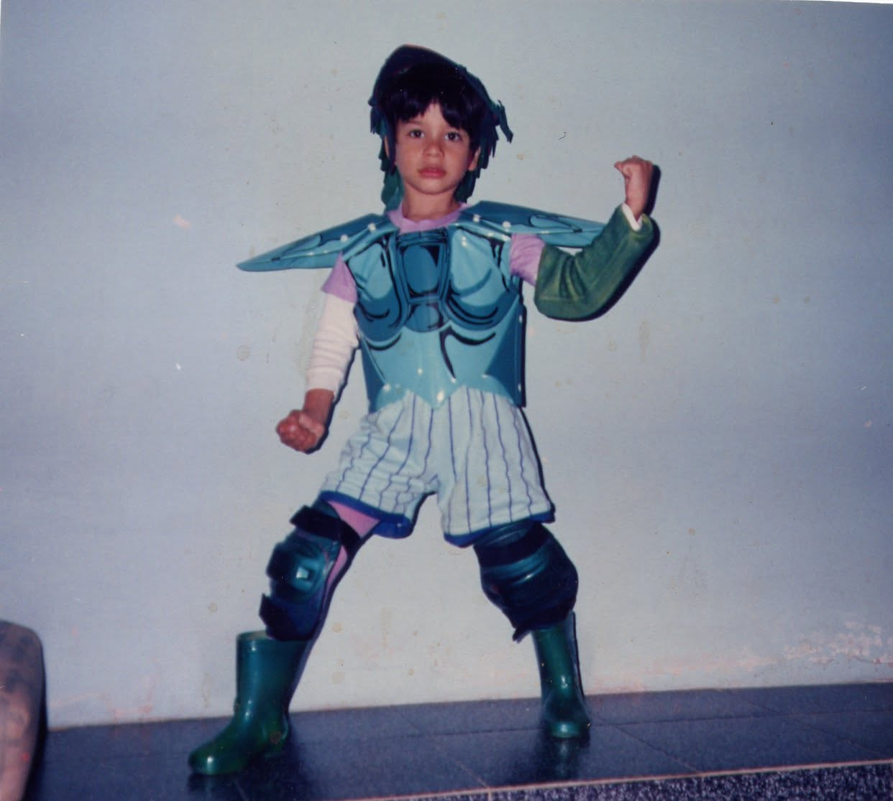
:::

::: {.column width="60%"}
My favorite books ... 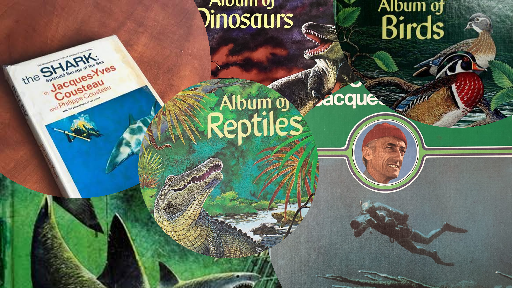{fig-align="center"}
:::
:::::

## The very beginning {auto-animate="TRUE"}

::::: columns
::: {.column width="40%"}

:::

::: {.column width="60%"}
My favorite movies ...

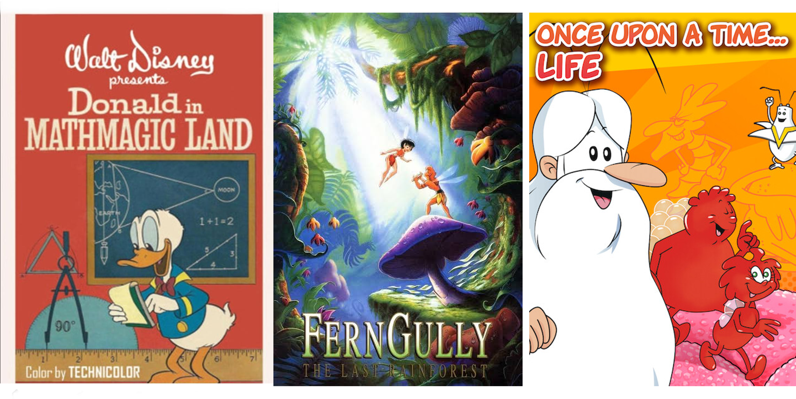{fig-align="center"}
:::
:::::


## My years as an ecologist

:::: {.columns}
::: {.column width="45%"}
::: {.r-stack}
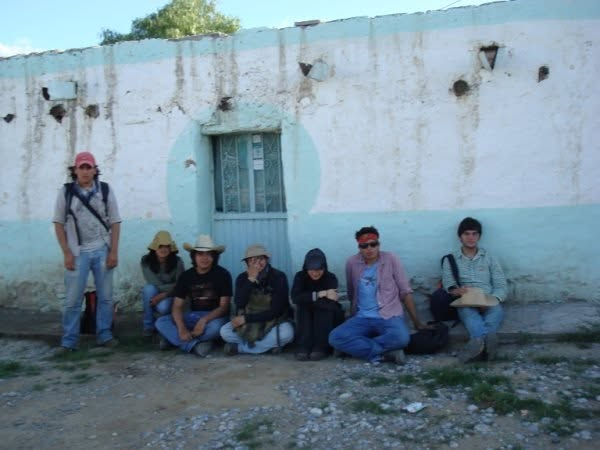{.fragment .fade-in-then-out fragment-index=1}

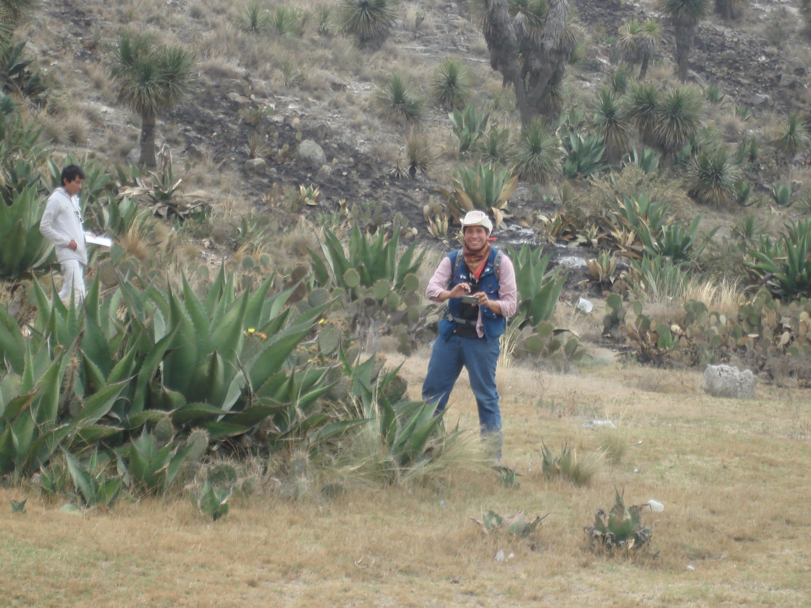{.fragment fragment-index=2}
:::
:::

::: {.column width="55%"}
::: {.fragment fragment-index=1}
- Studied Biology at UNAM, México
:::

::: {.fragment fragment-index=2}
- Fieldwork in semi-arid environments, working on plant ecophysiology
:::

::: {.fragment fragment-index=3}
- What I loved: being outdoors, natural history and ...
:::

::: {.fragment fragment-index=4}
complicated things (you will see next)
:::
:::
::::


## The question that hooked me {.smaller auto-animate="TRUE"}

::: statement
Does priming affect the germination response of two perennial herb species in a disturbed lava field in central Mexico?
:::

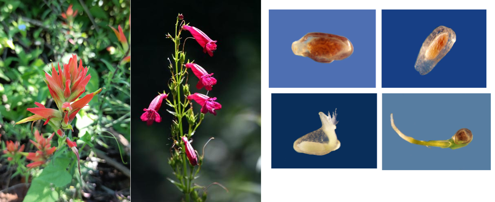{fig-align="center" width="549"}

## The question that hooked me {.smaller auto-animate="TRUE"}

:::::: columns
::: {.column width="45%"}
Lots of field and lab work

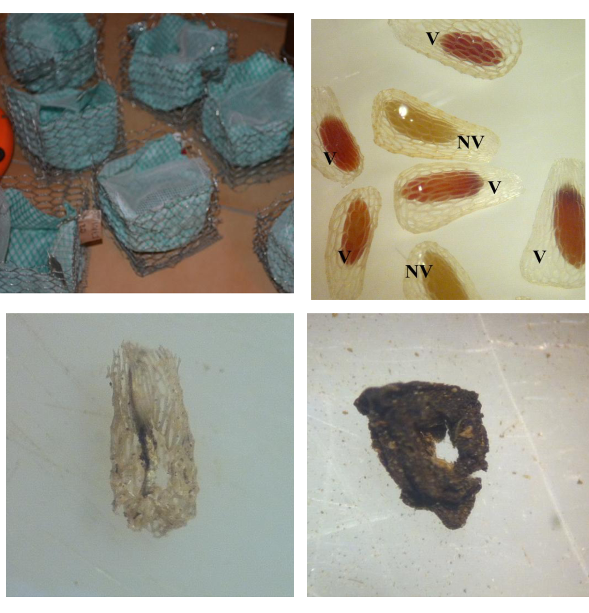{fig-align="center" width="530"}
:::

:::: {.column width="45%"}

:::{.fragment}
Once I recovered the seeds and exposed them to different treatments
:::

::: incremental
- How to model germination?
- How to determine if different priming treatments influence the germination?
- How do you quantify uncertainty?
- Not all the seeds are recovered . . .
  - a few of them had already germinated
  - some were dead
  - some were rocks
:::
::::
::::::

## The question that hooked me {.smaller auto-animate="TRUE"}

I needed answers but ...

::: fragment
I didn't quite understand the tools that gave me those answers
:::

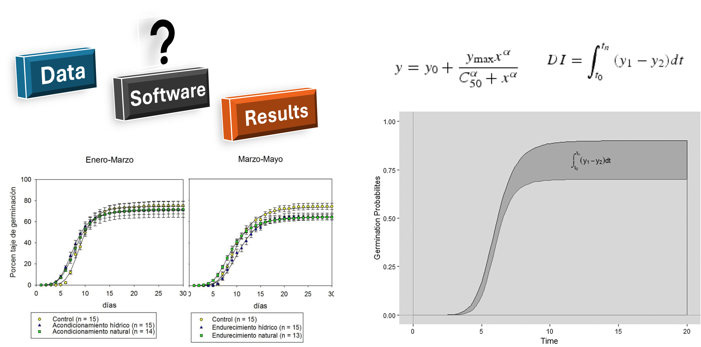{fig-align="center"}

# [Part II]{.kicker} The turning point {.part background-color="#163A4A" background-gradient="linear-gradient(135deg, #1F5C3A 0%, #011451 100%)"}

## Nature is messy, and so are its data {.smaller}

[Complex systems, observed in complicated ways.]{.lead}

::::::: columns
::::: {.column width="50%"}
:::: {.panel .eco}
[How we observe nature]{.panel-title}

::: incremental
- **Imperfect detection**: animals get missed
- **Correlation** in space and time
- **Uneven**, often opportunistic, sampling
- Many **zeros**, a few huge counts, **gaps**
- **Models** unique to Ecology, (e.g., predator-prey, von Bertalanffy growth, Capture-recapture, distance sampling , and many more )
:::
::::
:::::

::: {.column width="45%"}
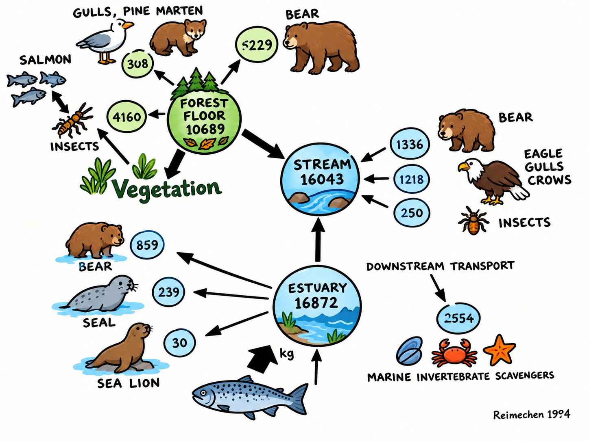{fig-align="center"}
:::
:::::::

::: fragment
"**A perfect model of reality is as complex as reality itself**"
:::

## The moment it clicked

::::::: columns
:::: {.column width="50%"}
::: {.panel .eco}
[Before]{.panel-title}

\[Statistics felt like a recipe I had to follow to analyse ecological data\]
:::
::::

:::: {.column width="50%"}
::: {.panel .stats .fragment}
[After]{.panel-title}

\[Statistics became a way of thinking about the ecology\]
:::
::::
:::::::

::: {.callout-tip .fragment}
## What changed

Curiosity: I wanted to understand what I was doing
:::

::: {.fragment .punchline}
"I have no special talent. I am only passionately curious."

[Albert Einstein, letter to Carl Seelig (1952)]{.who}
:::

# [Part III]{.kicker} Becoming a statistician {.part background-color="#011451"}

## Learning a new language

::::::: columns
:::: {.column width="50%"}
::: {.panel .eco}
[What ecology gave me]{.panel-title}

- Intuition for how data are generated
- Interpreting the results within the context of the problem.
- Knowing what my models assumptions were (even though I didn't understand why these were needed)
- Questions worth answering
:::
::::

:::: {.column width="50%"}
::: {.panel .stats .fragment}
[What I had to learn]{.panel-title}

- Calculus, Linear Algebra, Differential equations, etc.
- Probability theory and statistical inference.
- Programming (`R`, `C++`)
- Computational methods (Newton-Raphson, MCMC, INLA)
:::
::::
:::::::

::: fragment
Postgraduate studies in Applied Statistics & Environmental Statistics, followed with PhD and postdoc at UofG
:::

## Not an easy journey

:::::::: columns
:::: {.column width="50%"}
::: {.panel .eco}
[**My lectures in Ecology ...**]{.panel-title}

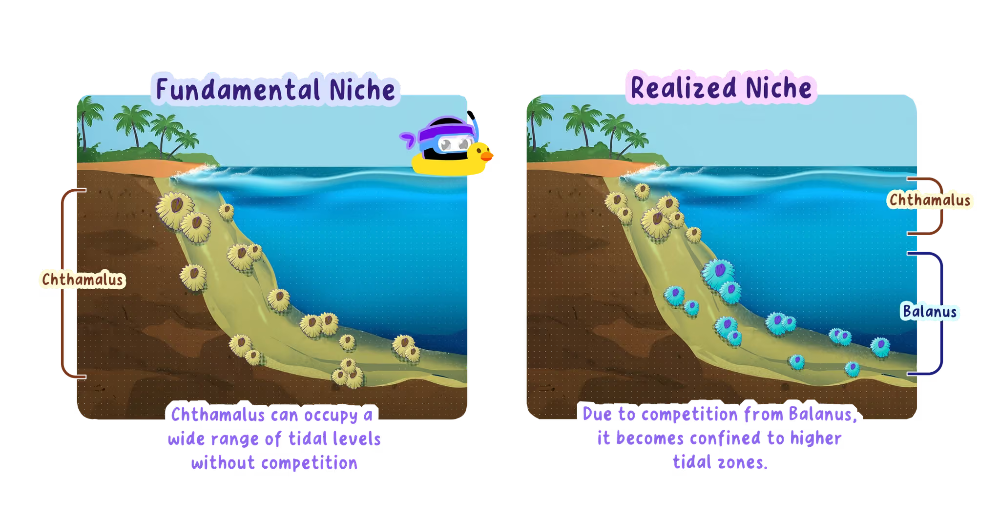
:::
::::

::::: {.column width="50%"}
:::: {.panel .stats .fragment}
[**My first lecture in Statistics ...**]{.panel-title}

A board full of equations I couldn't connect to my data

::: board
$$
p(y \mid \theta) = \binom{n}{y}\,\theta^{y}(1-\theta)^{n-y},
\\
\pi(\theta) = \frac{\theta^{a-1}(1-\theta)^{b-1}}{B(a,b)}
$$

$$
\begin{aligned}
\pi(\theta \mid y) &= \frac{p(y \mid \theta)\,\pi(\theta)}{\int_0^1 p(y \mid \theta)\,\pi(\theta)\,d\theta} \\
&\propto \theta^{y}(1-\theta)^{n-y}\;\theta^{a-1}(1-\theta)^{b-1} \\
&= \theta^{(a+y)-1}\,(1-\theta)^{(b+n-y)-1}
\end{aligned}
$$

$$
\theta \mid y \sim \text{Beta}(a + y,\; b + n - y)
$$

```{=html}
<svg width="0" height="0" style="position:absolute" aria-hidden="true">
  <filter id="chalk">
    <feTurbulence type="fractalNoise" baseFrequency="0.8" numOctaves="2" seed="4" result="noise"/>
    <feDisplacementMap in="SourceGraphic" in2="noise" scale="2.2"
                       xChannelSelector="R" yChannelSelector="G"/>
  </filter>
</svg>
```
:::
::::
:::::
::::::::

## Finding the links

[It took me a while to understand the links.]{.lead}

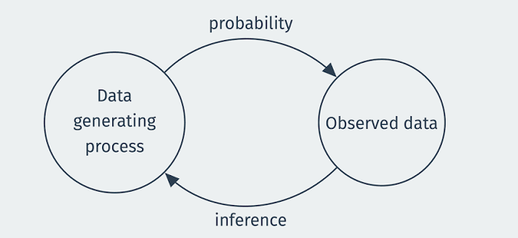{fig-align="center" width="409"}

## Finding the links

[It took me a while to understand the links.]{.lead}

::::::: columns
:::: {.column width="50%"}
::: {.panel .eco}
[In ecology]{.panel-title}

I was taught to think about the **data** and the **ecological problem**
:::
::::

:::: {.column width="50%"}
::: {.panel .stats .fragment}
[In statistics]{.panel-title}

I learned proofs and theorems for "*basic models*", but most didn't fit my data, because… **ecological data are messy**
:::
::::
:::::::

::: fragment
**The PhD:** building my own tools on what was already there
:::

:::::: {.journey .short}
::: {.stop .fragment}
[01]{.num}

**Basic models**

[Understand the foundations]{.what}
:::

::: {.stop .fragment}
[02]{.num}

**Complex models**

[See how they build on them]{.what}
:::

::: {.stop .fragment}
[03]{.num}

**My own tools**

[Models made for messy ecological data]{.what}
:::
::::::

## Same question, new tools

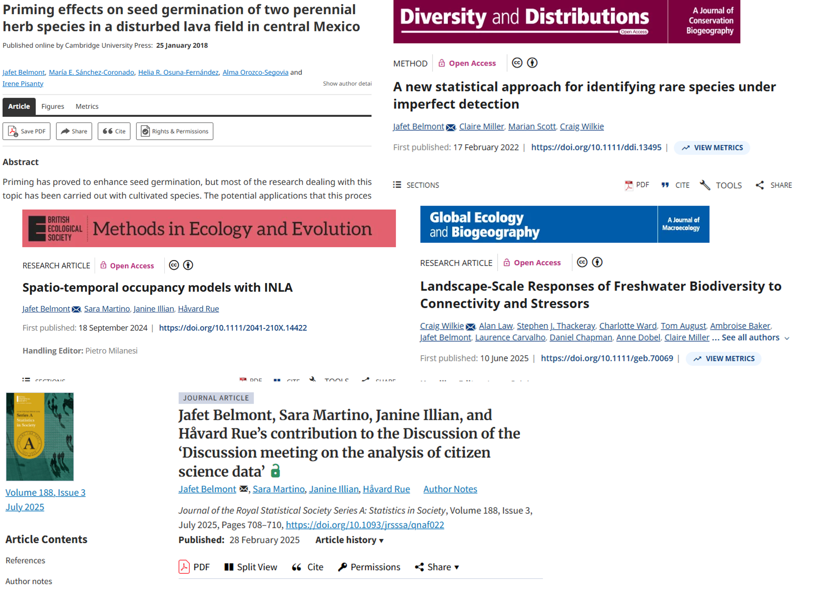{fig-align="center"}

# [Part IV]{.kicker} Where I am now {.part background-color="#011451"}

## Research today

:::::: cards
::: card
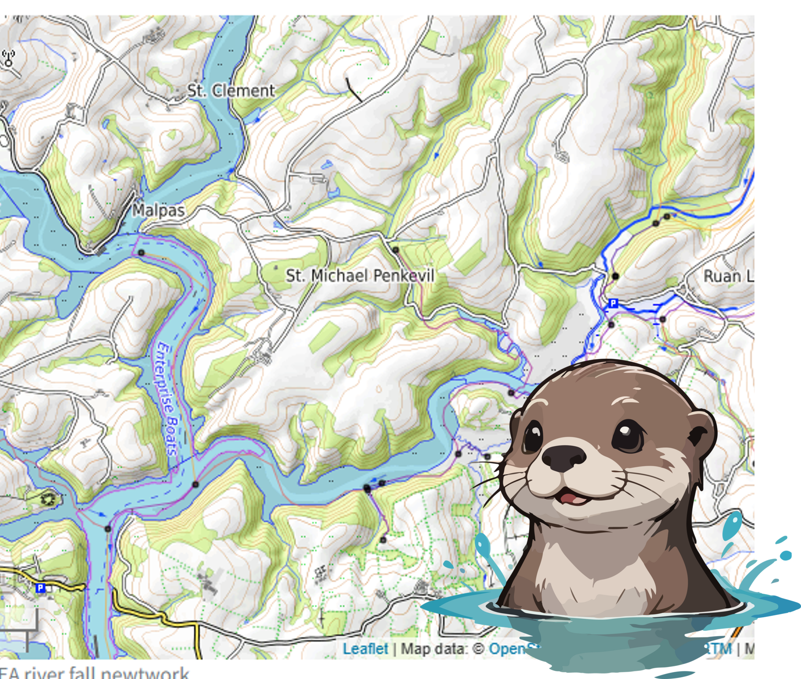{fig-align="center"}

[Biodiversity river monitoring]{.card-title}

Spatio-temporal models for detection-non detection data in river networks.
:::

::: card
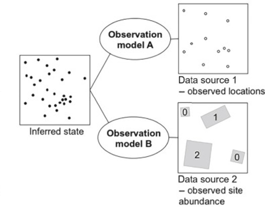{fig-align="center"}

[Integrated Models]{.card-title}

Combine information from different surveys to provide a better description of the state of nature
:::

::: card
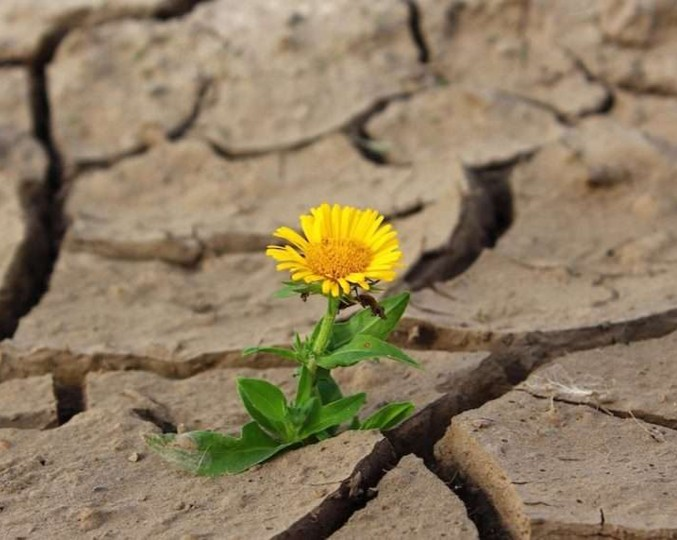{fig-align="center"}

[Extremes in Ecology]{.card-title}

Understand the impact of extreme events on ecological systems
:::
::::::

## What I enjoyed back then

**The Places**

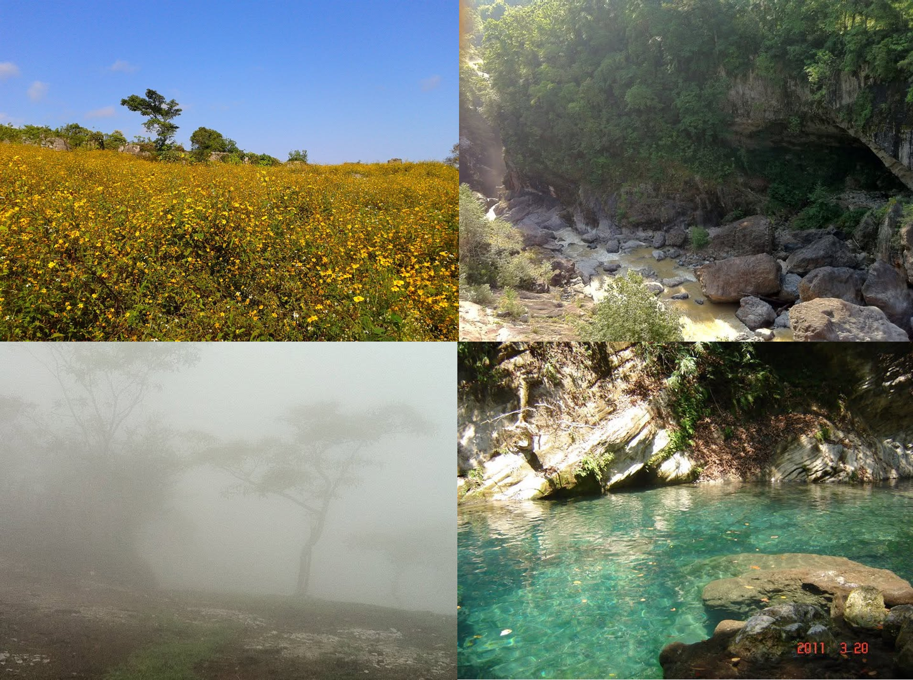{fig-align="center"}

## What I enjoyed back then

**Los bichos (the creepy-crawlies)**

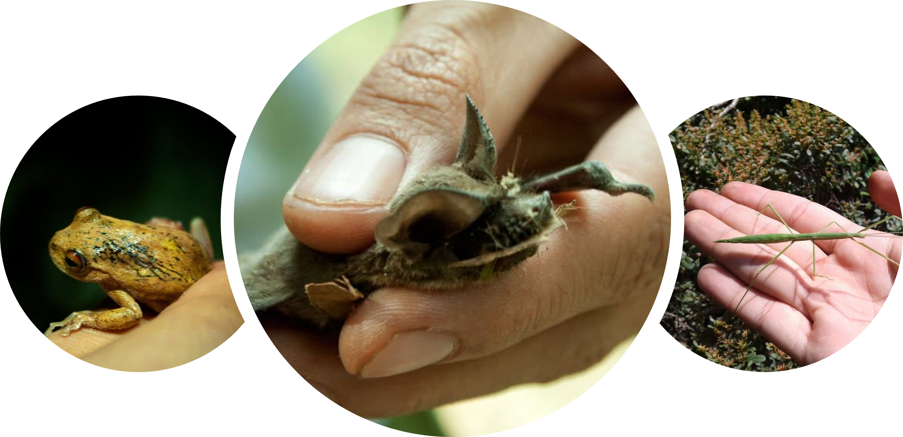{fig-align="center"}

## What I enjoyed back then

**The people**

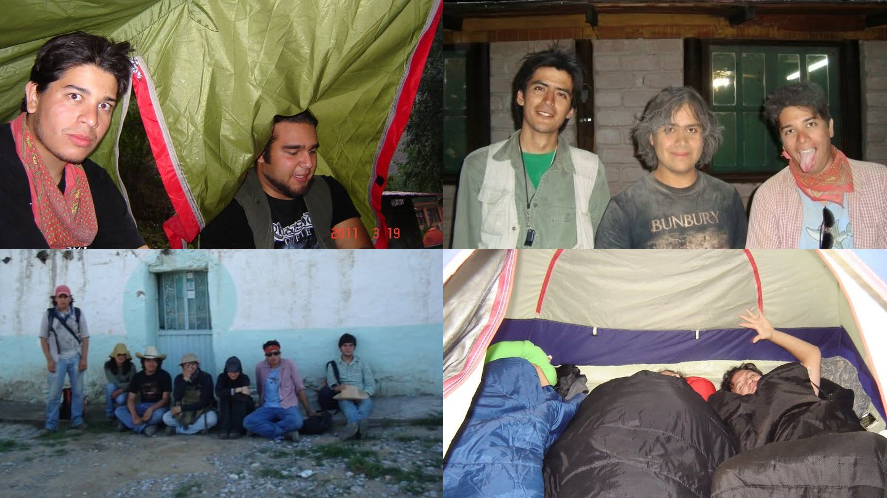{fig-align="center"}

## I never really left ecology

::: lead
Back then, I studied the system and collected data to understand it.<br> What I really enjoyed was the puzzle: *what could the data tell me?*
:::

::: {.statement .compact .fragment}
Ecology still asks hard questions.<br> But now the joy is in finding compelling answers through *Statistics*
:::

## What I enjoyed now

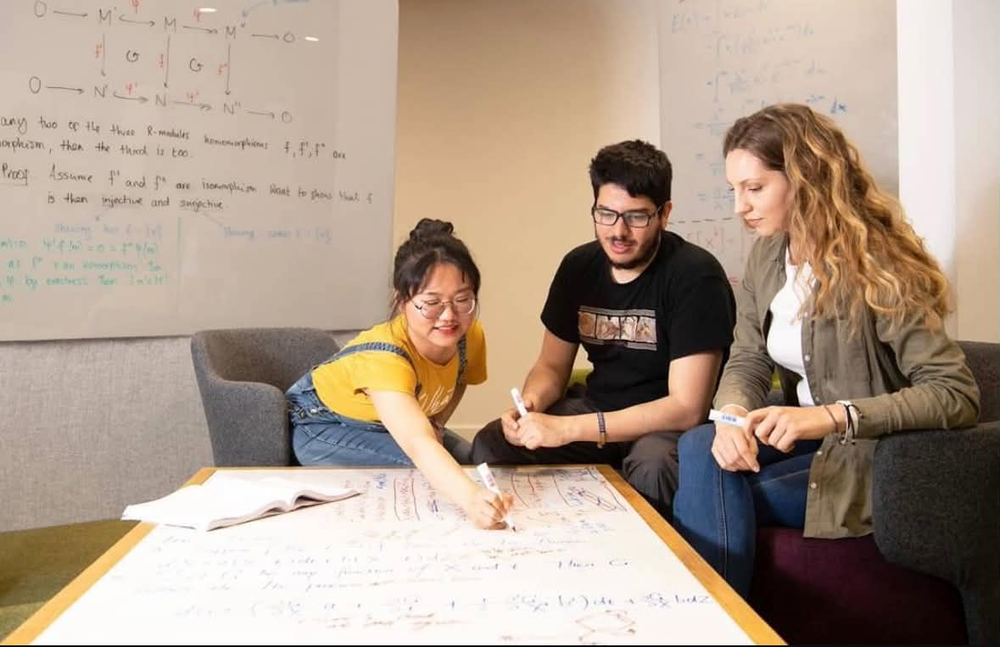{fig-align="center"}

## If you're an ecologist getting into statistics

::: takeaways
1.  Your field knowledge is an asset, not a detour.
2.  Learn the language one model at a time.
3.  Find collaborators on both sides.
4.  Allow yourself to step out of your comfort zone.
:::

## If you're a statistician getting into ecology

::: takeaways
1.  Understand the ecological question and the system
2.  Ask how the data were collected
3.  Messy data are the interesting part, not a nuisance
4.  Spend a day in the field if possible.
:::

## Thank you {.closing background-color="#0E3540" background-gradient="linear-gradient(135deg, #1F5C3A 0%, #011451 80%)"}

::: contact
Questions?

[Jafet.BelmontOsuna\@glasgow.ac.uk](jafet.belmontosuna@glasgow.ac.uk)
:::
