##  {background-image="river.png" background-size="100%"}

::: {style="height: 50px;"}
:::

::: quote-gold
> Space is inherent to all ecological processes, influencing dynamics such as migration, dispersal, and species interactions. A primary goal in ecology is to understand how these processes shape species distributions and dynamics across space.
:::

## Monitoring species distributions {background-image="city_plan.gif" background-size="100%"}

> Imagine planning a city without knowing where people live. This is exactly what we risk doing in conservation if we don't accurately map where species exist---and why.

## Monitoring species distributions {.smaller}

::::: columns
::: {.column width="40%"}
- Biodiversity monitoring programs have become essential to **understand** the spatial distribution of species.

- The analysis of species distribution data is **challenging**

- Spatial dependency can complicate statistical analysis and, if unaccounted for, it can **bias** our interpretation of the observed patterns.
:::

::: {.column width="60%"}
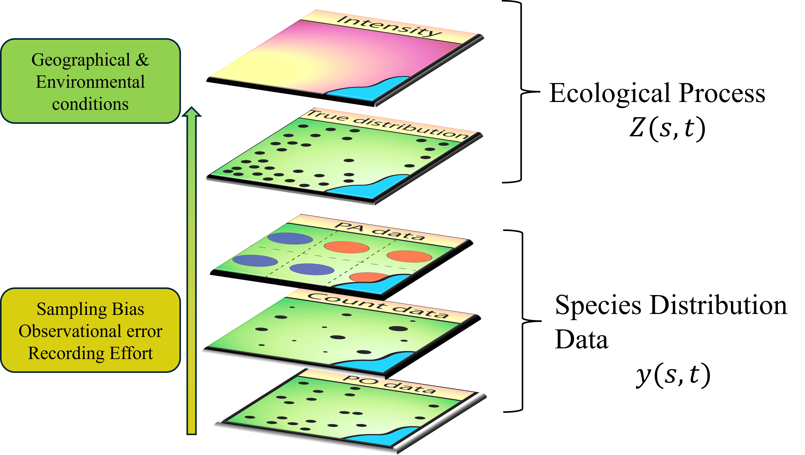{fig-align="center" width="100%" height="100%"}
:::
:::::

::: aside
Figure modified from [@mostert2023]
:::

## The Challenge of Data {.smaller}

- The information available for species distributions models is radically changing

- As the **volume** of recorded ecological data continues to grow, so does the need for **computationally efficient methods** for fitting complex models.

- One major challenge in spatial modelling is translating mathematical models into **code**

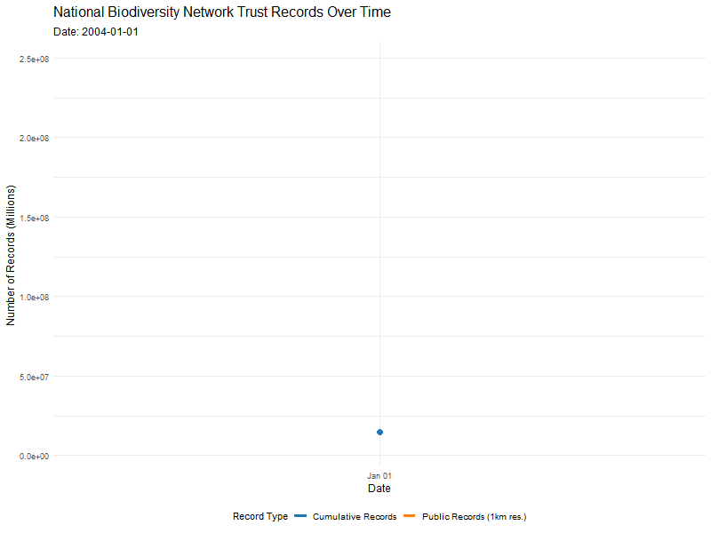{fig-align="center"}

## INLA in Ecology {.smaller auto-animate="true"}

The R-INLA package has become a powerful tool for fitting complex spatial models in ecology.

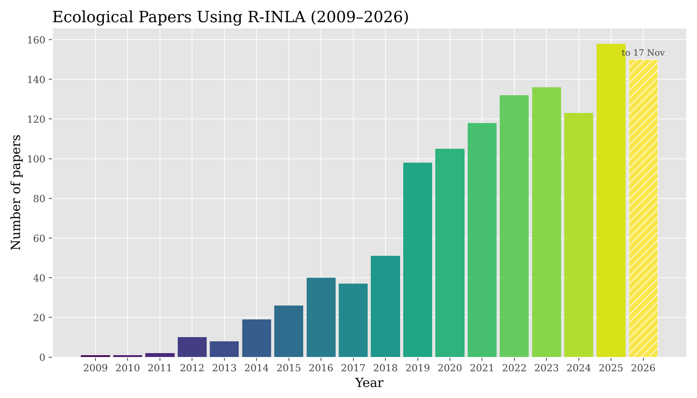{fig-align="center"}

## INLA in Ecology {.smaller auto-animate="true"}

::: {style="position: relative; padding-bottom: 56.25%; padding-top: 35px; height: 0; overflow: hidden;"}
<iframe sandbox="allow-popups allow-scripts allow-same-origin allow-presentation" allow="autoplay; fullscreen; encrypted-media; picture-in-picture" allowfullscreen="true" allowtransparency="true" frameborder="0" height="315" src="https://www.mentimeter.com/app/presentation/als852ohxxo1iuox6v8siwumcqcudx4u/embed" style="position: absolute; top: 0; left: 0; width: 100%; height: 100%;" width="420">

</iframe>
:::

<!-- {fig-align="center"} -->

## What is INLA and `inlabru`? {.smaller auto-animate="true"}

- **Short Answer**

> The Integrated Nested Laplace Approximation (INLA) is a fast method to do Bayesian inference with latent Gaussian models and `inlabru` is an R-package that implements this method with a flexible and simple interface.

## What is INLA and `inlabru`? {.smaller auto-animate="true"}

- **Short Answer**

> The Integrated Nested Laplace Approximation (INLA) is a fast method to do Bayesian inference with latent Gaussian models and `inlabru` is an R-package that implements this method with a flexible and simple interface.

- **The (much) longer answer**
  - Rue, H., Martino, S. and Chopin, N. (2009), Approximate Bayesian inference for latent Gaussian models by using integrated nested Laplace approximations. *Journal of the Royal Statistical Society: Series B (Statistical Methodology)*, 71: 319-392.
  - Van Niekerk, J., Krainski, E., Rustand, D., & Rue, H. (2023). A new avenue for Bayesian inference with INLA. *Computational Statistics & Data Analysis*, 181, 107692.
  - Lindgren, F., Bachl, F., Illian, J., Suen, M. H., Rue, H., & Seaton, A. E. (2024). inlabru: software for fitting latent Gaussian models with non-linear predictors. *arXiv preprint* arXiv:2407.00791.
  - Lindgren, F., Bolin, D., & Rue, H. (2022). The SPDE approach for Gaussian and non-Gaussian fields: 10 years and still running. *Spatial Statistics*, 50, 100599.

## Latent Gaussian Models ... with an example {.smaller auto-animate="true"}

- Most commonly used models are actually LGMs (e.g., LM,LMM, GLM, GAM,etc)

- A LGM consists of three elements:

## Latent Gaussian Models ... with an example {.smaller auto-animate="true"}

- Most commonly used models are actually LGMs (e.g., LM,LMM, GLM, GAM,etc)

- A LGM consists of three elements:

  1.  **The observation model** $\pi(\mathbf{y}|\eta,\theta) = \prod_{i=1}^n \pi(y_i|\eta_,\theta)$

  The data generating process

$$\begin{aligned}
y_i &\sim \mathcal{N}(\mu_i,\sigma_\epsilon^{2})\\
\eta_i &= \mu_i = \beta_0 + \beta_1 x_i
\end{aligned}$$

## Latent Gaussian Models ... with an example {.smaller auto-animate="true"}

- Most commonly used models are actually LGMs (e.g., LM,LMM, GLM, GAM,etc)

- A LGM consists of three elements:

  1.  **The observation model** $\pi(\mathbf{y}|\eta,\theta) = \prod_{i=1}^n \pi(y_i|\eta_,\theta)$

  2.  **The latent Gaussian field** $\pi(\mathbf{u}|\theta)$

  The dependence structure

$$\begin{aligned}
\begin{bmatrix}
\beta_0 \\ \beta_1 \end{bmatrix} 
&\sim \mathcal{N}\left(\mathbf{0},\mathrm{Q}^{-1}
\right)\\
\mathrm{Q} & =
\begin{bmatrix}
\tau_{\beta_0} & 0 \\ 0 & \tau_{\beta_1}
\end{bmatrix}
\end{aligned}$$

## Latent Gaussian Models ... with an example {.smaller auto-animate="true"}

- Most commonly used models are actually LGMs (e.g., LM,LMM, GLM, GAM,etc)

- A LGM consists of three elements:

  1.  **The observation model** $\pi(\mathbf{y}|\eta,\theta) = \prod_{i=1}^n \pi(y_i|\eta_,\theta)$

  2.  **The latent Gaussian field** $\pi(\mathbf{u}|\theta)$

  3.  a vector of non-Gaussian **hyperparameters** $\theta$

  $$\tau_{\epsilon} = 1/ \sigma_\epsilon^{2}$$

## Latent Gaussian Models ... with an example {.smaller auto-animate="true"}

- Most commonly used models are actually LGMs (e.g., LM,LMM, GLM, GAM,etc)

- A LGM consists of three elements:

  1.  **The observation model** $\pi(\mathbf{y}|\eta,\theta) = \prod_{i=1}^n \pi(y_i|\eta_,\theta)$

  2.  **The latent Gaussian field** $\pi(\mathbf{u}|\theta)$

  3.  a vector of non-Gaussian **hyperparameters** $\theta$

- The characteristic property is that the latent part of the hierarchical model is Gaussian, where the expected value is 0 and the precision matrix is Q.

- We can use INLA to compute $\pi(\mathbf{u},\theta|\mathbf{y}) \propto \pi(\mathbf{y}|\mathbf{u},\theta)\pi(\mathbf{u}|\theta)\pi(\theta)$

## Real-world datasets are more complicated! {.smaller}

Data can have several dependence structures: temporal, spatial,...

Using a Bayesian framework:

- Build (hierarchical) models to account for potentially complicated dependency structures in the data.
- Attribute uncertainty to model parameters and latent variables using priors.

Need computationally efficient methods to calculate posteriors (this is where INLA and `R-INLA` helps!).

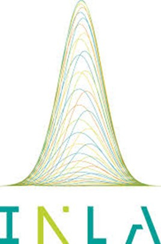{fig-align="center" width="200"}

## Why `inlabru`? {.smaller scrolling="true" auto-animate="TRUE"}

:::::: columns
::: {.column width="50%"}
- Fitting spatial models in `R-INLA` interface can be cumbersome for new (and even experienced) users!

{fig-align="center" width="400"}
:::

:::: {.column width="50%"}
::: panel-tabset
# Point process model with `R-INLA`

```{r}
#| eval: false
#| echo: true
#| code-overflow: scroll

domain.polys <- Polygons(list(Polygon(loc.d)), '0')
domainSP <- SpatialPolygons(list(domain.polys))

# Because the mesh is larger than the study area, we need to
# compute the intersection between each polygon
# in the dual mesh and the study area
library(rgeos)

w <- sapply(1:length(dmesh), function(i) {
  if (gIntersects(dmesh[i, ], domainSP))
    return(gArea(gIntersection(dmesh[i, ], domainSP)))
  else return(0)
})
# Projection matrix for the integration points (mesh vertices)
A.int <- Diagonal(nv, rep(1, nv))
# Projection matrix for observed points (event locations)
A.y <- inla.spde.make.A(mesh = mesh, loc = coo)
# Projection matrix for mesh vertices and event locations
A.pp <- rbind(A.int, A.y)
Ap.pp <- inla.spde.make.A(mesh = mesh, loc = coop)
# stack for estimation
stk.e.pp <- inla.stack(tag = "est.pp",
data = list(y = y.pp, e = e.pp), 
A = list(1, A.pp),
effects = list(list(b0 = rep(1, nv + n)), list(s = 1:nv)))

# stack for prediction stk.p
stk.p.pp <- inla.stack(tag = "pred.pp",
data = list(y = rep(NA, nrow(coop)), e = rep(0, nrow(coop))),
A = list(1, Ap.pp),
effects = list(data.frame(b0 = rep(1, nrow(coop))),
               list(s = 1:nv)))

# stk.full has stk.e and stk.p
stk.full.pp <- inla.stack(stk.e.pp, stk.p.pp)
formula <- y ~ 0 + b0 + f(s, model = spde)
res <- inla(formula,  family = 'poisson',
data = inla.stack.data(stk.full.pp),
control.predictor = list(compute = TRUE, link = 1,
                         A = inla.stack.A(stk.full.pp)),
E = inla.stack.data(stk.full.pp)$e)
```
:::
::::
::::::

## Why `inlabru`? {.smaller scrolling="true" auto-animate="TRUE"}

::::::: columns
:::: {.column width="50%"}
- Fitting spatial models in `R-INLA` interface can be cumbersome for new (and even experienced) users!
- In many cases, complicated spatial models are just special cases of the same model structure!!

::: incremental
- Stage 1: What is the distribution of the responses?
- Stage 2: What are the model components? and what is their distribution?
- Stage 3: What are our prior beliefs about the parameters controlling the components in the model?
:::
::::

:::: {.column width="50%"}
::: panel-tabset
# Point process model with `R-INLA`

```{r}
#| eval: false
#| echo: true
#| code-overflow: scroll

domain.polys <- Polygons(list(Polygon(loc.d)), '0')
domainSP <- SpatialPolygons(list(domain.polys))

# Because the mesh is larger than the study area, we need to
# compute the intersection between each polygon
# in the dual mesh and the study area
library(rgeos)

w <- sapply(1:length(dmesh), function(i) {
  if (gIntersects(dmesh[i, ], domainSP))
    return(gArea(gIntersection(dmesh[i, ], domainSP)))
  else return(0)
})
# Projection matrix for the integration points (mesh vertices)
A.int <- Diagonal(nv, rep(1, nv))
# Projection matrix for observed points (event locations)
A.y <- inla.spde.make.A(mesh = mesh, loc = coo)
# Projection matrix for mesh vertices and event locations
A.pp <- rbind(A.int, A.y)
Ap.pp <- inla.spde.make.A(mesh = mesh, loc = coop)
# stack for estimation
stk.e.pp <- inla.stack(tag = "est.pp",
data = list(y = y.pp, e = e.pp), 
A = list(1, A.pp),
effects = list(list(b0 = rep(1, nv + n)), list(s = 1:nv)))

# stack for prediction stk.p
stk.p.pp <- inla.stack(tag = "pred.pp",
data = list(y = rep(NA, nrow(coop)), e = rep(0, nrow(coop))),
A = list(1, Ap.pp),
effects = list(data.frame(b0 = rep(1, nrow(coop))),
               list(s = 1:nv)))

# stk.full has stk.e and stk.p
stk.full.pp <- inla.stack(stk.e.pp, stk.p.pp)
formula <- y ~ 0 + b0 + f(s, model = spde)
res <- inla(formula,  family = 'poisson',
data = inla.stack.data(stk.full.pp),
control.predictor = list(compute = TRUE, link = 1,
                         A = inla.stack.A(stk.full.pp)),
E = inla.stack.data(stk.full.pp)$e)
```
:::
::::
:::::::

## Why `inlabru`? {.smaller scrolling="true"}

:::::: columns
::: {.column width="50%"}
- Fitting spatial models in `R-INLA` interface can be cumbersome for new (and even experienced) users!

- In many cases, complicated spatial models are just special cases of the same model structure!!

  - Stage 1: What is the distribution of the responses?
  - Stage 2: What are the model components? and what is their distribution?
  - Stage 3: What are our prior beliefs about the parameters controlling the components in the model?

- `inlabru` keeps a consistent workflow no matter how complicated your model is
:::

:::: {.column width="50%"}
::: panel-tabset
# Point process model with `inlabru`

```{r}
#| eval: false
#| echo: true
#| code-line-numbers: "1-3|5-6|8-12|13-14"
# Step 1. Define model components
cmp <- component_1(...) + 
  component_2(...) + ...

# Step 2. Define the model predictor
pred <- geometry ~ component_1 + component_2 + ...

# Step 3. Build the observation model
lik <- bru_obs(formula = pred,
               family = "cp" ,
               data = sf_object ,
                ...)
# Step 4. Fit the model
fit <- bru(comps, lik, ...)

```
:::
::::
::::::

## Why `inlabru`? {.smaller auto-animate="true"}

**In summary**

::: incremental
- **Consistent** workflow and user-friendly interface.

- Facilitate **spatial modelling** and **prediction** using Integrated Nested Laplace approximation

- Support of commonly used spatial **data formats** like `sf` and `terra`

- Extends `R-INLA` functionality to more general **nonlinear predicto**r expressions via a **fixed point iteration** scheme.
:::

::: fragment
- It is named after **Scotland's favorite** soft drink

{fig-align="center" width="25%" height="25%"}
:::

##  {background-image="landscape_Eff2.gif" background-size="100%"}

::: {style="height: 300px;"}
:::

::: {.blockquote style="color: #FFFFFF; background-color:rgb(38, 38, 38,0.8); font-size: 1.5em; padding: 20px; border-radius: 5px;"}
Determining the scale effects of landscape variables
:::

## Scale effect in Ecology

- Landscape studies often explore the impact of surrounding landscapes on abiotic or biotic responses at specific locations (selected for their differing landscape features).

- A key challenge in these studies is to identify the spatial scale at which these landscape factors affect the response variable.

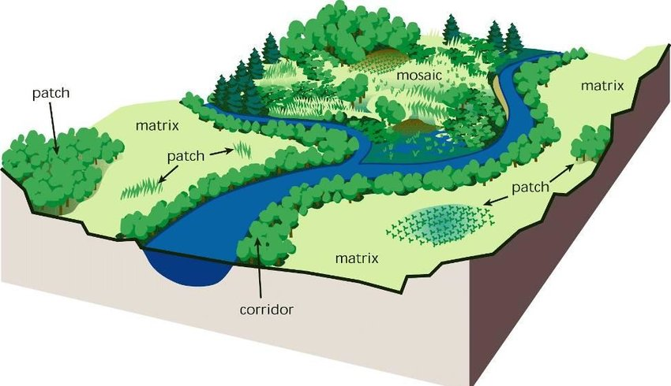{fig-align="center"}

## Methods for determining scale effect {.smaller auto-animate="true"}

The two most commonly used methods for estimating landscape effects are *threshold* and *distance-weighted* methods.

**Threshold methods** compare landscape variables across multiple buffer sizes centred at specific habitat patches, and then select the scale that best fits the data.

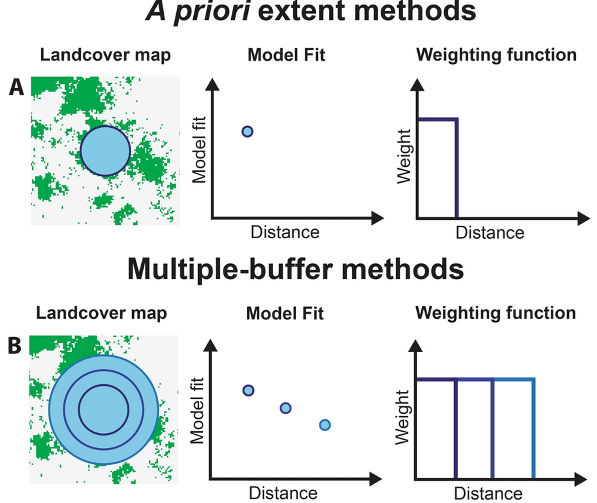{fig-align="center"}

## Methods for determining scale effect {.smaller auto-animate="true"}

The two most commonly used methods for estimating landscape effects are *threshold* and *distance-weighted* methods.

**Threshold methods** compare landscape variables across multiple buffer sizes centred at specific habitat patches, and then select the scale that best fits the data.

There are several issues with this approach:

- Choosing the maximum and minimum buffer sizes and the number of buffers to evaluate
- The larger the number of buffers to evaluate, the more models we need to fit leading to inflated Type 1 errors
- High degree of spatial autocorrelation between buffers
- Assume an uniform effect of the landscape features within a buffer

## Methods for determining scale effect {.smaller auto-animate="true"}

The two most commonly used methods for estimating landscape effects are *threshold* and *distance-weighted* methods.

*Distance-weighted* methods assign continuous weights to landscape variables, giving greater importance to areas nearer to the study sites and less to those farther away.

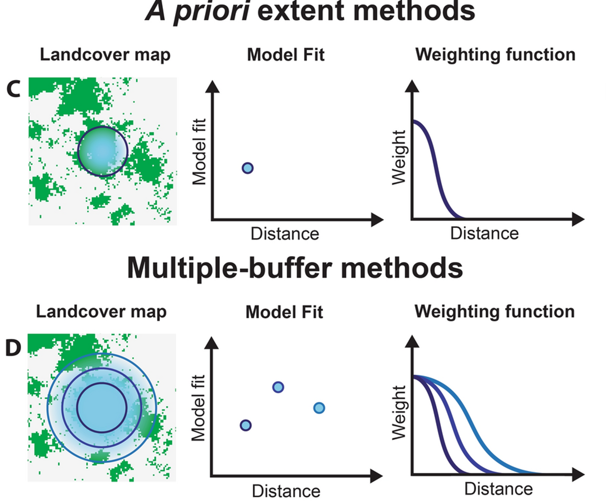{fig-align="center"}

## The Kernel function {.smaller auto-animate="true"}

*Distance-weighted* summarise landscape variables by calculating a weighted average, where the weights $w$ are determined using a known kernel function.

- These kernels are defined by the distance between the sample location $i$ and the surrounding locations.

- Usually an exponential or a Gaussian kernel are assumed for the shape of $w(\cdot)$ e.g.,

$$w(\mathbf{s}_i,\mathbf{s}_j,\sigma) = \dfrac{\mathrm{exp(-||\mathbf{s}_i-\mathbf{s}_j||^2/2\sigma^2)}}{\sum_{i\neq j} \mathrm{exp}(-||\mathbf{s}_i-\mathbf{s}_j||^2/2\sigma^2)}$$

- $\sigma$, the scale parameter, describes how rapidly the effects of the landscape variables decline with the Euclidean distance between locations.
- Smaller $\sigma$ values indicate that nearby locations have a larger weight, whereas large $\sigma$ place large weights on distant values of the covariate(s) of interest. The goal is then to estimate $\{\beta,\sigma,u_i\}$.

## The Kernel function {.smaller auto-animate="true"}

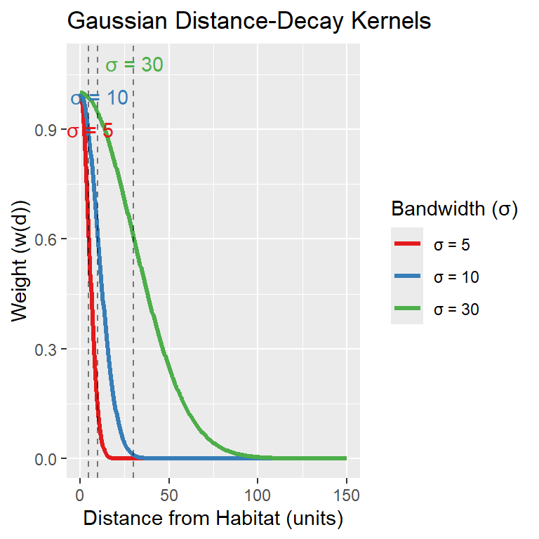{fig-align="center"}

## Species distribution model {.smaller}

A simple species distribution model can be specified as follows:

$$\begin{aligned}
y_i &\sim \mathrm{Bernoulli}(\theta_i)  \\
\log \left(\frac{\theta_i}{1 - \theta_i} \right) &= \beta_0+ \sum_{k\in K} \beta_k s_k(x^k(\mathbf{s}_i,\sigma)) + u_i , \\
s_k(x^k(\mathbf{s}_i,\sigma)) & = \sum_{i\neq j}  x^k(\mathbf{s}_j)w(\mathbf{s}_i,\mathbf{s}_j,\sigma)
\end{aligned}$$

- $s_k(z^k(\mathbf{x}_i,\sigma))$ is the weighted average of the $k$th landscape variable $z^k$ with weights $w(\cdot)$ and $\beta^k$ are the effects of such spatially weighted variables.

- We just need one extra step for estimating $\sigma$ , for which we can use the iterated INLA linearisation step in `inlabru`.

## Simulation Study {.smaller auto-animate="true"}

Simulation study and comparing the results from fitting model with `inlabru` against an MLE approach [@chandler2016].

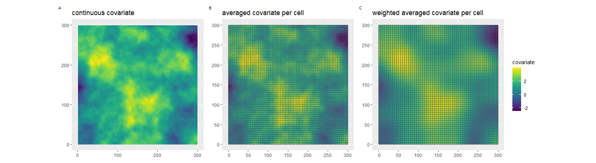{fig-align="center"}

## Simulation Study {.smaller auto-animate="true"}

Simulation study and comparing the results from fitting model with `inlabru` against an MLE approach [@chandler2016].

Simulated true presence-absence data according to the following occupancy probabilities:

$$\mathrm{logit}(\psi_i) = \beta_0 + \beta_1 \times f(x(\mathbf{s}_i,\sigma))$$

**Survey data** consist of a random sample of 10% of the total grid cells ( $n=360$ ) where the true presence/absence data are recorded.

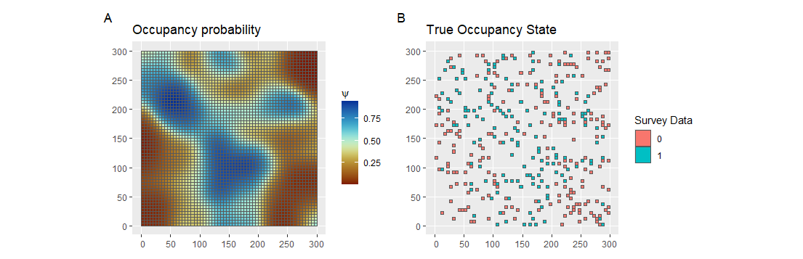{fig-align="center"}

## Simulation Study {.smaller auto-animate="true"}

Simulation study and comparing the results from fitting model with `inlabru` against an MLE approach (@chandler2016).

**Results**

::::: columns
::: {.column width="30%"}
| Parameter | True | MLE   | `inlabru` |
|-----------|------|-------|-----------|
| $\beta_0$ | -3   | -3.11 | -2.96     |
| $\beta_1$ | 1.5  | 1.58  | 1.5       |
| $\sigma$  | 15   | 14.1  | 13.88     |
:::

::: {.column width="70%"}
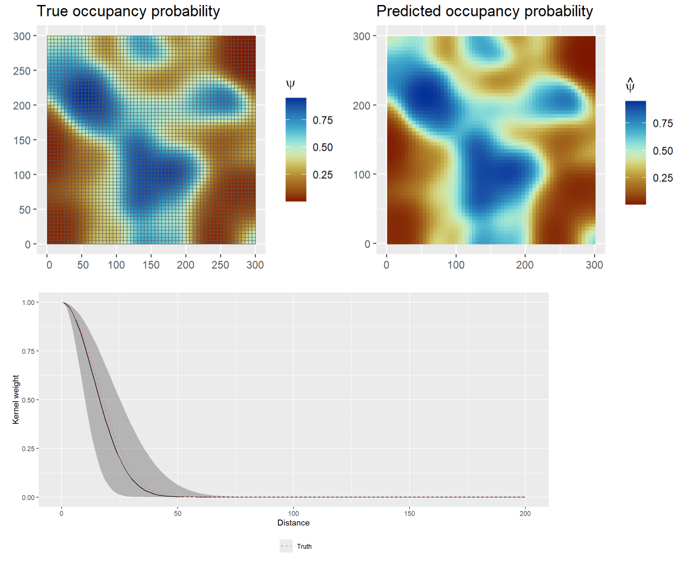{fig-align="center" width="546"}
:::
:::::

## What do we gain with `inlabru`? {.smaller auto-animate="true"}

Several `R` packages now facilitate the analysis of landscape effects

| Package | Data format support | Buffer scale analysis | Distance weighted analysis | Spatial random effects | Account for observational processess |
|------------|------------|:-----------|------------|------------|------------|
| `multilandr` | `terra` rasters | ✅ | ❌ | ❌ | ❌ |
| `siland` | `sf` shapefiles | ✅ | ✅ | ❌ | ❌ |
| `scalescape` | `terra` rasters | ❌ | ✅ | ✅ | ❌ |

## What do we gain with `inlabru`? {.smaller auto-animate="true"}

Several `R` packages now facilitate the analysis of landscape effects

| Package | Data format support | Buffer scale analysis | Distance weighted analysis | Spatial random effects | Account for observational processess |
|------------|------------|:-----------|------------|------------|------------|
| `multilandr` | `terra` rasters | ✅ | ❌ | ❌ | ❌ |
| `siland` | `sf` shapefiles | ✅ | ✅ | ❌ | ❌ |
| `scalescape` | `terra` rasters | ❌ | ✅ | ✅ | ❌ |
| `inlabru` | `terra` and `sf` |  |  |  |  |

- Support of different landscape data formats (rasters or shapefiles)

## What do we gain with `inlabru`? {.smaller auto-animate="true"}

Several `R` packages now facilitate the analysis of landscape effects

| Package | Data format support | Buffer scale analysis | Distance weighted analysis | Spatial random effects | Account for observational processess |
|------------|------------|:-----------|------------|------------|------------|
| `multilandr` | `terra` rasters | ✅ | ❌ | ❌ | ❌ |
| `siland` | `sf` shapefiles | ✅ | ✅ | ❌ | ❌ |
| `scalescape` | `terra` rasters | ❌ | ✅ | ✅ | ❌ |
| `inlabru` | `terra` and `sf` | ✅ | ✅ |  |  |

- Support of different landscape data formats (rasters or shapefiles)

- Provides flexibility with user-defined kernel functions (defined as regular r expressions)

## What do we gain with `inlabru`? {.smaller auto-animate="true"}

Several `R` packages now facilitate the analysis of landscape effects

| Package | Data format support | Buffer scale analysis | Distance weighted analysis | Spatial random effects | Account for observational processess |
|------------|------------|:-----------|------------|------------|------------|
| `multilandr` | `terra` raster | ✅ | ❌ | ❌ | ❌ |
| `siland` | `sf` shapefiles | ✅ | ✅ | ❌ | ❌ |
| `scalescape` | `terra` raster | ❌ | ✅ | ✅ | ❌ |
| `inlabru` | `terra` and `sf` | ✅ | ✅ | ✅ |  |

- Support of different landscape data formats (rasters or shapefiles)

- Provides flexibility with user-defined kernel functions (defined as regular r expressions)

- Capabilities to fit explicit spatial or spatio-temporal models

## What do we gain with `inlabru`? {.smaller auto-animate="true"}

Several `R` packages now facilitate the analysis of landscape effects

| Package | Data format support | Buffer scale analysis | Distance weighted analysis | Spatial random effects | Account for observational processess |
|------------|------------|:-----------|------------|------------|------------|
| `multilandr` | `terra` rasters | ✅ | ❌ | ❌ | ❌ |
| `siland` | `sf` shapefiles | ✅ | ✅ | ❌ | ❌ |
| `scalescape` | `terra` rasters | ❌ | ✅ | ✅ | ❌ |
| `inlabru` | `terra` and `sf` | ✅ | ✅ | ✅ | ✅ |

- Support of different landscape data formats (rasters or shapefiles)

- Provides flexibility with user-defined kernel functions (defined as regular r expressions)

- Capabilities to fit explicit spatial or spatio-temporal models

- Multiple response types (e.g, binary, counts, continuous).

- Account for complex observational processes (e.g., imperfect detection)

## What do we gain with `inlabru`? {.smaller auto-animate="true"}

Several `R` packages now facilitate the analysis of landscape effects

| Package | Data format support | Buffer scale analysis | Distance weighted analysis | Spatial random effects | Account for observational processess |
|------------|------------|:-----------|------------|------------|------------|
| `multilandr` | `terra` rasters | ✅ | ❌ | ❌ | ❌ |
| `siland` | `sf` shapefiles | ✅ | ✅ | ❌ | ❌ |
| `scalescape` | `terra` rasters | ❌ | ✅ | ✅ | ❌ |
| `inlabru` | `terra` and `sf` | ✅ | ✅ | ✅ | ✅ |

- Support of different landscape data formats (rasters or shapefiles)

- Provides flexibility with user-defined kernel functions (defined as regular r expressions)

- Capabilities to fit explicit spatial or spatio-temporal models

- Multiple response types (e.g, binary, counts, continuous).

- Account for complex observational processes (e.g., imperfect detection)

- **Combining multiple data sources?**

##  {background-image="IDM_video2.gif" background-size="100%"}

::: {style="height: 250px;"}
:::

::: {.blockquote style="color: #FFFFFF; background-color:rgb(38, 38, 38,0.8); font-size: 1.5em; padding: 20px; border-radius: 5px;"}
Combining efforts: Integrating multiple Data sources for modelling species distributions
:::

## The new era of biodiversity data {.smaller}

- The rise of **new technologies** and **data submission platform**s have provided access to multiple data sources

- New opportunities for studying the **spatial distributions** of wildlife populations.

- Datasets are typically **designed** with a particular goal in mind.

{fig-align="center"}

## Planned **Structured** Survey Data {.smaller auto-animate="true"}

- Planned Surveys produce **structured data** which involves constant monitoring schemes using standardised methods at sites on a regular basis.

![Figure modified from [@guillera-arroita2016]](images/survey_data.png){fig-align="center"}

## Planned **Structured** Survey Data {.smaller auto-animate="true"}

- Planned Surveys produce **structured data** which involves constant monitoring schemes using standardised methods at sites on a regular basis.

- These are **expensive** to collect and tend to be geographically and temporally restricted.

{fig-align="center"}

## Citizen Science **Unstructured** Data {.smaller auto-animate="true"}

**Unstructured data** constitute the majority of available information.

- **Citizen science** projects offer a cost-effective solution to investigate species distributions at large spatial and temporal scales.

{fig-align="center"}

## Citizen Science Data {.smaller auto-animate="true"}

**Unstructured data** constitute the majority of available information.

- **Citizen science** projects offer a cost-effective solution to investigate species distributions at large spatial and temporal scales.
- Harnessing the power of CS data is not an easy task!

| Advantages 😄👍 | Disadvantages 😔👎 |
|----------------------------------------|--------------------------------|
| Extensive taxonomic, spatial and temporal coverage. | Under-reporting of rare and inconspicuous species. |
| Eye-catching species that are easily identifiable by participants. | Varying recording skills and uneven sampling effort. |

## Data Integration {.smaller auto-animate="true"}

How can we combine the information from different data sources?

- **Data integration**: aims to describe explicitly the differences in how datasets were assembled by using distinct observation submodels for each data source.

![Obtained from [@isaac2020]](images/data_int2.jpg){fig-align="center"}

## Data Integration {.smaller auto-animate="true"}

How can we combine the information from different data sources?

- **Data integration**: aims to describe explicitly the differences in how datasets were assembled by using distinct observation submodels for each data source.

- Combining different data sources is challenging due to differences in study design, spatial and temporal coverage, and potential **sampling biases**.

{fig-align="center"}

##  {background-image="CS.gif" background-size="100%"}

## Sampling Bias in CS opportunistic data {.smaller}

Large volumes of CS data come from **Opportunistic surveys** where sampling effort is **biased** across space and time.

- People visit more certain places than others.

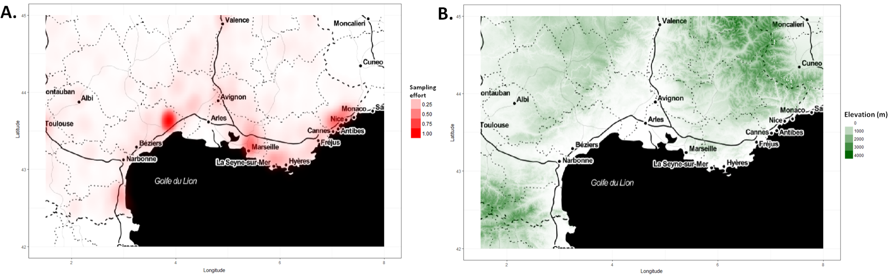{fig-align="center"}

::: incremental
- Small populations at lower elevation could be over-sampled.

- If we assume sampling is evenly distributed, species occupancy at higher elevation would be under-estimated
:::

## Thinned point process model {.smaller auto-animate="true"}

- The true locations $\mathbf{s}=s_1,\ldots,s_m$ where a species occur are a realization of a Point Process, specifically a log-Gaussian Cox process (LGCP).

$$\lambda(s)=\exp\{X(s)'\beta + Z(s)\}$$

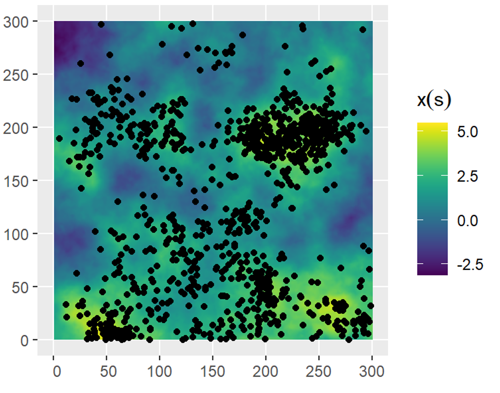{fig-align="center"}

## Thinned point process model {.smaller auto-animate="true"}

- The true locations $\mathbf{s}=s_1,\ldots,s_m$ where a species occur are a realization of a Point Process, specifically a log-Gaussian Cox process (LGCP).
- The true point pattern is partially observed due to **imperfect detection** and **accessibility constrains** reflected by an uneven sampling effort.

{fig-align="center"}

## Thinned point process model {.smaller auto-animate="true"}

- The true locations $\mathbf{s}=s_1,\ldots,s_m$ where a species occur are a realization of a Point Process, specifically a log-Gaussian Cox process (LGCP).
- The true point pattern is partially observed due to **imperfect detection** and **accessibility constrains** reflected by an uneven sampling effort

::::: columns
::: {.column width="40%"}
- The locations $\mathbf{s}=s_1,\ldots,s_n$ where opportunistic encounters have actually occurred are the result of a **thinned point process**.

$$\begin{aligned}
\lambda^{pp}(s)&=\lambda(s)\times p(s)\\
\text{logit}(p(s)) &= \alpha^{pp}_0 + \alpha^{pp}_1\times g(s) + \ldots
\end{aligned}$$
:::

::: {.column width="60%"}
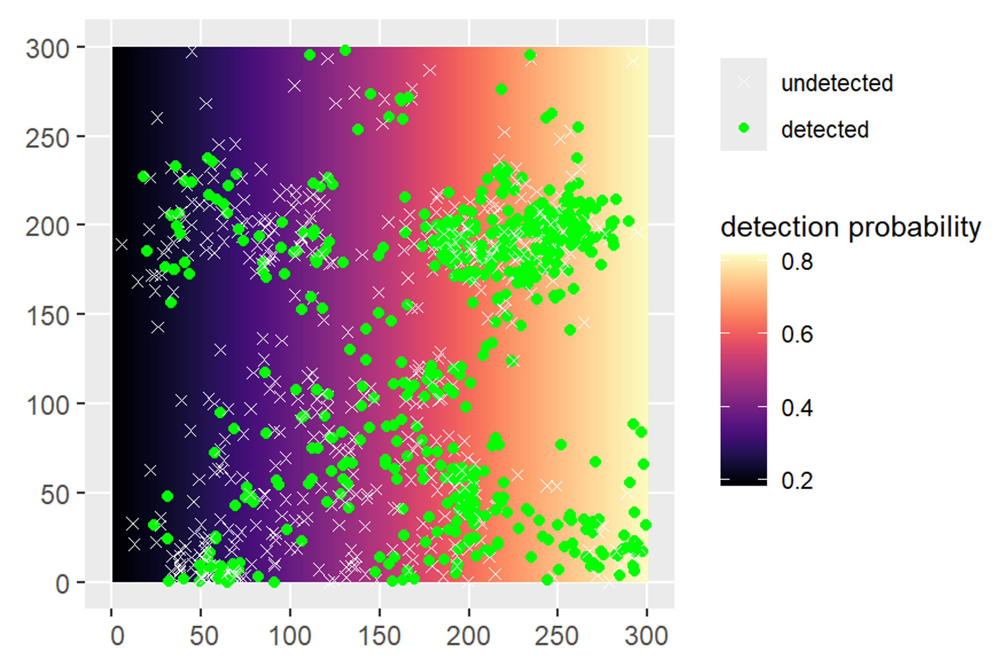{fig-align="center" width="100%" height="100%"}
:::
:::::

## Estimation of the thinned point process model {.smaller}

The likelihood function for the thinned point process is given by:

$$L_{thinn}(\beta,\alpha) = \exp\left\{\int_B\lambda(s) p(s) ds)\right\}\prod_i^m \lambda(s_i)p(s_i)$$

- @simpson2016 proposed an approach to approximate both the stochastic integral and the evaluation of the field at the data points using INLA.

- In `R-INLA` we can defined different model components as part of the additive predictor.

- `inlabru` allows the predictor to be a non-linear function of the parameter vector through an iterative model fitting scheme.

- We can use `inlabru` fixed point iteration method to estimate thinning probabilities $p(s)$.

##  {background-image="survey_video.gif" background-size="100%"}

## The problem with detection {auto-animate="true"}

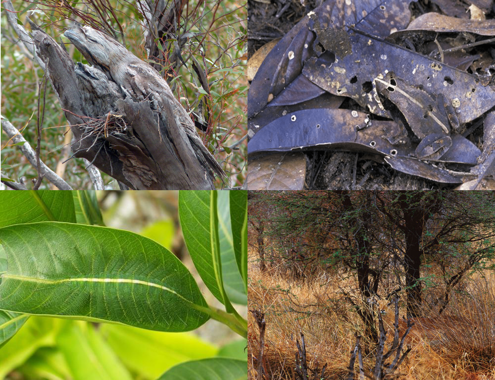{fig-align="center"}

## The problem with detection {auto-animate="true"}

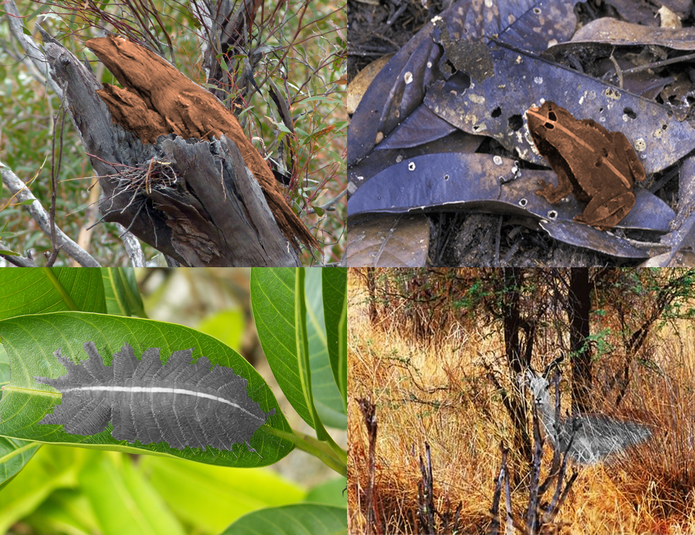{fig-align="center"}

## Possible biases due to imperfect detection

::: incremental
- Underestimation of species distribution

- Bias of the estimated relationship with covariates

- Predictive models might reflect detection instead of occurrence
:::

## The Occupancy model for survey data {.smaller auto-animate="true"}

**Basic idea:** Data contain information about two processes.

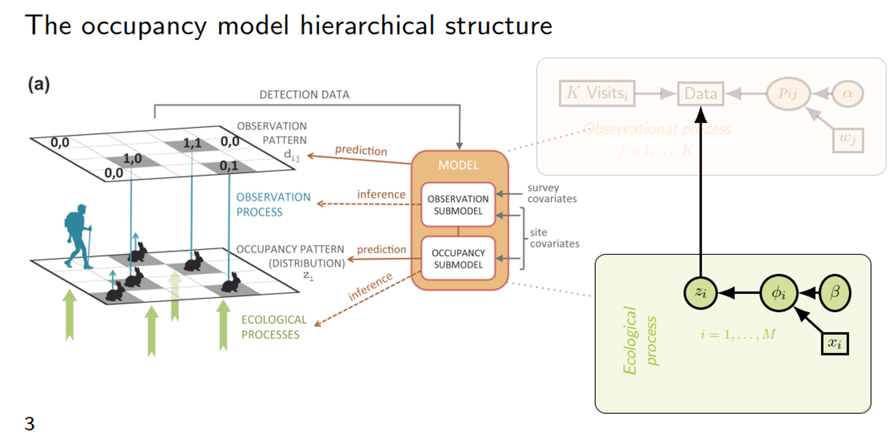{fig-align="center" width="100%" height="100%"}

## The Occupancy model for survey data {.smaller}

**Basic idea:** Data contain information about two processes.

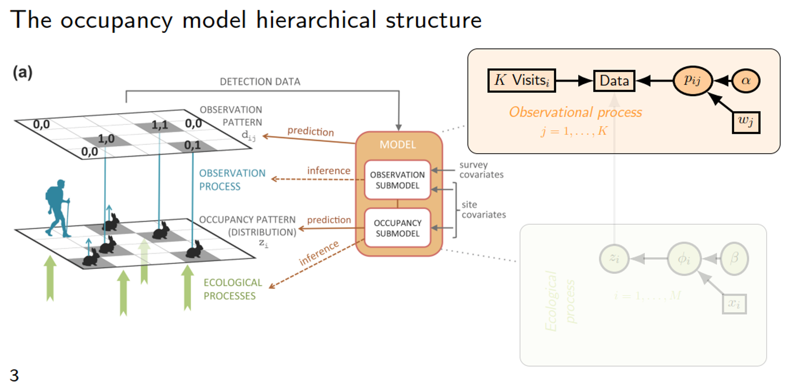{fig-align="center" width="100%" height="100%"}

## Occupancy Models in INLA {.smaller}

For a set of set of $M$ discrete sites, let the detection history of the $i$th site $\mathbf{d}_i= y_{i1},\ldots,y_{iK}$.

The joint likelihood is then:

$$ L(\pmb{\psi},\textbf{p}|\mathbf{y}_1,\ldots,\mathbf{y}_M) = \underbrace{\prod_{i=1}^{m} \left[\psi_i \prod_j^{K_i} p_{ij}^{y_{ij}} (1-p_{ij})^{1-y_{ij}}\right]}_{\text{sites with at least one detection}}\underbrace{\prod_{i=m+1}^M\left[\psi_i\prod_j^{K_i}(1-p_{ij})+(1-\psi_i)\right]}_{\text{sites with only 0's}}.$$

The likelihood for occupancy model is factorized into univariate models for the marginal distribution of each site detection history.

$$ L(\pmb{\psi},\textbf{p}|\mathbf{y}_1,\ldots,\mathbf{y}_M) = \prod_{i=1}^{M} \left[\psi_i \prod_j^{K_i} p_{ij}^{y_{ij}} (1-p_{ij})^{1-y_{ij}} + \mathbb{I}_{\sum_j y_{ij} = 0}(1-\psi_i) \right]$$

@belmont2024 show how this a LGM (and thus possible to be fitted using INLA ) under some mild conditions.

##  {background-image="Data Integration.gif" background-size="\"100%"}

## Integrated Species Distribution Model {.smaller auto-animate="true"}

- The point process model proposed for CS data is defined on a continuous space, but the occupancy model for survey data is defined in a discretised space.

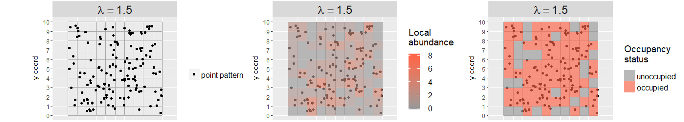{fig-align="center"}

## Integrated Species Distribution Model {.smaller auto-animate="true"}

- The point process model proposed for CS data is defined on a continuous space, but the occupancy model for survey data is defined in a discretised space.

{fig-align="center"}

- We can use the fact that the number of individuals in a bounded region can be characterized as $N(A_i)\sim \mathrm{Poisson}(\int_{A_i}\lambda(s)~ds)$.

- The probability that an areal unit $A_i$ is occupied by a species is given by:

$$\psi_i = \mathrm{Pr}\left[N(A_i)>0\right] = 1 - \exp\left(-\int_{A_i}\lambda(s)~ds\right),$$

## Integrated Species Distribution Model {.smaller auto-animate="true"}

- The point process model proposed for CS data is defined on a continuous space, but the occupancy model for survey data is defined in a discretised space.

- We can use the fact that the number of individuals in a bounded region can be characterized as $N(A_i)\sim \mathrm{Poisson}(\int_{A_i}\lambda(s)~ds)$.

- The probability that an areal unit $A_i$ is occupied by a species is given by:

$$\psi_i = \mathrm{Pr}\left[N(A_i)>0\right] = 1 - \exp\left(-\int_{A_i}\lambda(s)~ds\right),$$

Thus, the intensity-based OM likelihood becomes:

$$L(\psi_i,p_{ij}) = \left[\prod_i^N \left(1-\exp\left\{-\int_{A_i}\lambda(s) ds\right\}\right)\prod_j^{K_i}p_{ij}^{y_{ij}}(1-p_{ij})^{1-y_{ij}} \right] \times\\ \prod_{i=N+1}^M\left[ \left(1-\exp\left\{\int_{A_i}\lambda(s) ds\right\}\right) \prod_j^{K_i}(1-p_{ij})+\exp\left\{\int_{A_i} \lambda(s)ds\right\}  \right].$$

## Integrated Species Distribution Model {.smaller auto-animate="true"}

The marginal distribution of each site detection history is given by

$$ L(\pmb{\psi},\textbf{p}|\mathbf{y}_1,\ldots,\mathbf{y}_M) = \prod_{i=1}^{M} \left[1-\exp\left\{-\int_{A_i}\lambda(s) ds\right\} \prod_j^{K_i} p_{ij}^{y_{ij}} (1-p_{ij})^{1-y_{ij}} + \mathbb{I}_{\sum_j y_{ij} = 0}\exp\left\{\int_{A_i} \lambda(s)ds\right\}\right]$$

::: incremental
- In large-scale studies, species distributions are often monitored across relatively small patches.

- If we assume a constant intensity within each cell then $\int_{A_i}\lambda(s)ds = \lambda_i |A_i|$.
:::

## Integrated Species Distribution Model {.smaller auto-animate="true"}

The marginal distribution of each site detection history is given by

$$ L(\pmb{\psi},\textbf{p}|\mathbf{y}_1,\ldots,\mathbf{y}_M) = \prod_{i=1}^{M} \left[1-\exp\left\{-\int_{A_i}\lambda(s) ds\right\} \prod_j^{K_i} p_{ij}^{y_{ij}} (1-p_{ij})^{1-y_{ij}} + \mathbb{I}_{\sum_j y_{ij} = 0}\exp\left\{\int_{A_i} \lambda(s)ds\right\}\right]$$

- In large-scale studies, species distributions are often monitored across relatively small patches.

- If we assume a constant intensity within each cell then $\int_{A_i}\lambda(s)ds = \lambda_i |A_i|$.

- We can link the occupancy probabilities to the intensity function ($\psi_i = 1 -\exp(|A_i|\lambda_i)$) through the cloglog link ($\mathrm{cloglog}(\psi) =\log[-\log(1-\psi_i)]$)

$$\begin{aligned}
\mathrm{cloglog}(\psi_i) &=  \log(|A_i|) + \log(\lambda_i) \\
&= \log(|A_i|)+\beta_0 + \sum_{q=1}^P\beta_q x_{iq} + z_i\\
&= \beta_0^* + \sum_{q=1}^P\beta_q x_q(s) + z_i
\end{aligned}$$

## Integrated Species Distribution Model {.smaller auto-animate="true"}

The marginal distribution of each site detection history is given by

$$ L(\pmb{\psi},\textbf{p}|\mathbf{y}_1,\ldots,\mathbf{y}_M) = \prod_{i=1}^{M} \left[1-\exp\left\{-\int_{A_i}\lambda(s) ds\right\} \prod_j^{K_i} p_{ij}^{y_{ij}} (1-p_{ij})^{1-y_{ij}} + \mathbb{I}_{\sum_j y_{ij} = 0}\exp\left\{\int_{A_i} \lambda(s)ds\right\}\right]$$

- In large-scale studies, species distributions are often monitored across relatively small patches.

- If we assume a constant intensity within each cell then $\int_{A_i}\lambda(s)ds = \lambda_i |A_i|$.

- We can link the occupancy probabilities to the intensity function ($\psi_i = 1 -\exp(|A_i|\lambda_i)$) through the cloglog link ($\mathrm{cloglog}(\psi) =\log[-\log(1-\psi_i)]$)

$$\begin{aligned}
\mathrm{cloglog}(\psi_i) &= \beta_0^* + \sum_{q=1}^P\beta_q x_q(s) + z_i
\end{aligned}$$

- The likelihood of the integrated model becomes $L_{\text{idm}}(\beta,\alpha,\gamma) = L_{pp}(\beta,\alpha) \times L_{occ}(\beta,\gamma)$

## Case Study: Modelling the Distribution of the black-throated blue warbler in Pennsylvania, USA. {.smaller}

- Occurrence data for the Black-throated blue warbler (*Setophaga caerulescens*) in Pennsylvania, USA are available from two sources:

1.  The **Pennsylvania Breeding Bird Atlas** (BBA): *Point count surveys* collected through a standardized data collection protocol from 2005 to 2008 .

2.  The second data set does not follow a standard data collection protocol, but instead are observations reported by citizen scientists to the **eBird** platform in 2008.

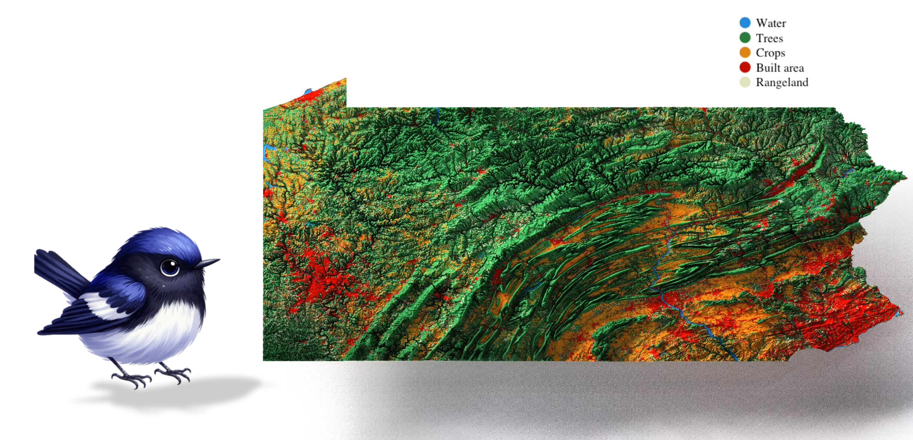{fig-align="center"}

## Modelling Black-throated blue warbler: Survey Data {.smaller auto-animate="true"}

- Detection/non-detection BBA survey data are available in a subregion of the Pennsylvania State.

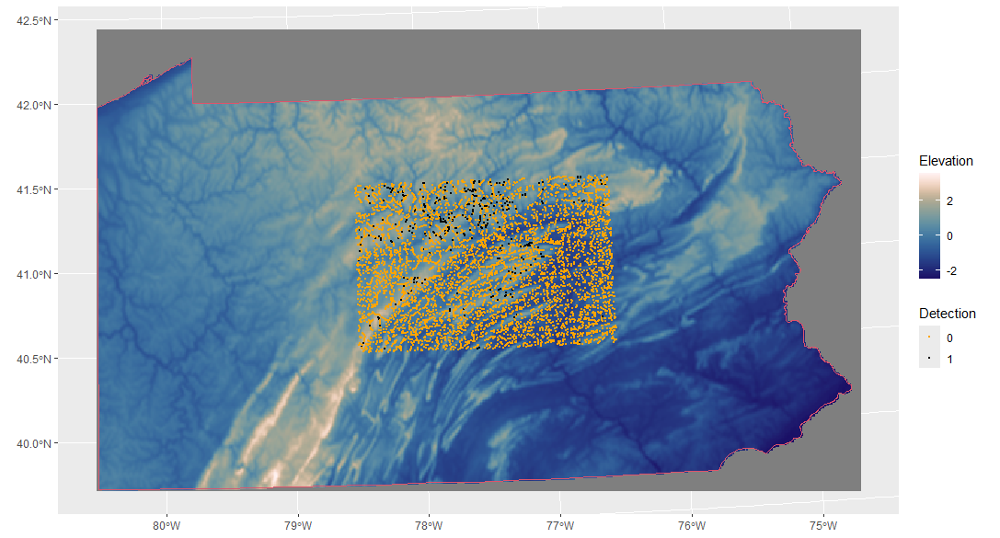{fig-align="center"}

## Modelling Black-throated blue warbler: Opportunistic Data {.smaller auto-animate="true"}

- `eBird` citizen science data are usually biased due to **uneven sampling effort**.
- Use the locations where other species have been observed as a proxy of sampling intensity

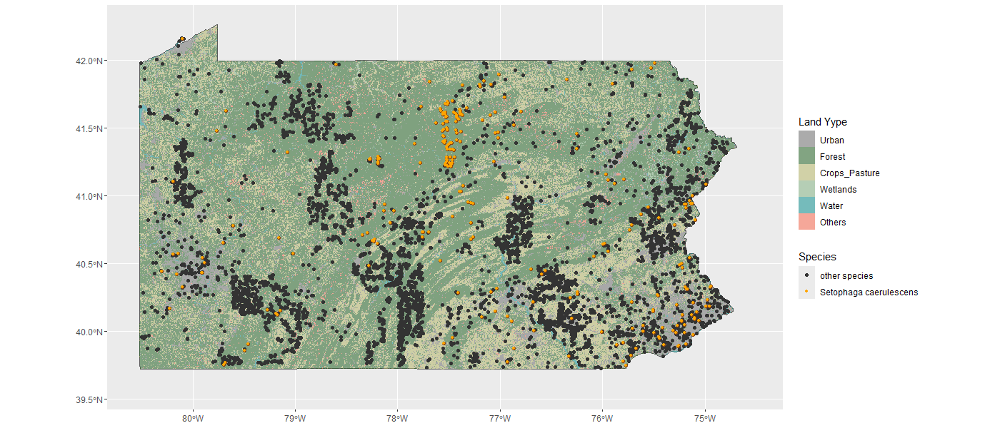{fig-align="center"}

## Modelling Black-throated blue warbler: Modeling BBA and eBird together {.smaller auto-animate="true"}

- `inlabru` facilitates fitting multi-likelihood models that share a common state-space process parameters but have different observational processes.

$$\begin{aligned}
\log(\lambda(s)^{(\text{eBird})}) &= \color{black}{\beta_0} + \color{black}{\beta'X(s)} + \color{black}{Z(s)} + \log(p(s)) \\
\mathrm{logit}(p(s)^{(\text{eBird})}) &= \alpha_0 + \alpha_1 \times \hat{\text{effort}}(s)\\
\mathrm{cloglog}(\psi(s)^{(\text{BBA})}) &=  |C_i| + \color{black}{\beta_0} + \color{black}{\beta'X(s)} + \color{black}{Z(s)} \\
\mathrm{logit}(p_{ij}^{(\text{BBA})}) &= \gamma_0 + \gamma_1 \times \text{Canopy} + \gamma_2 \times \text{LDI}
\end{aligned}$$ - LDI is the *land development index* proposed by @brown2005. The smaller the index values is, the less the urban development is.

## Modelling Black-throated blue warbler: Modeling BBA and eBird together {.smaller auto-animate="true"}

- `inlabru` facilitates fitting multi-likelihood models that share a common state-space process parameters but have different observational processes.

$$\begin{aligned}
\log(\lambda(s)^{(\text{eBird})}) &= \color{red}{\beta_0} + \color{red}{\beta'X(s)} + \color{red}{Z(s)} + \log(p(s)) \\
\mathrm{logit}(p(s)^{(\text{eBird})}) &= \alpha_0 + \alpha_1 \times \hat{\text{effort}}(s)\\
\mathrm{cloglog}(\psi(s)^{(\text{BBA})}) &=  |C_i| + \color{red}{\beta_0} + \color{red}{\beta'X(s)} + \color{red}{Z(s)} \\
\mathrm{logit}(p_{ij}^{(\text{BBA})}) &= \gamma_0 + \gamma_1 \times \text{Canopy} + \gamma_2 \times \text{LDI}
\end{aligned}$$ - LDI is the *land development index* proposed by @brown2005. The smaller the index values is, the less the urban development is.

## Modelling Black-throated blue warbler: Modeling BBA and eBird together {.smaller auto-animate="true"}

- `inlabru` facilitates fitting multi-likelihood models that share a common state-space process parameters but have different observational processes.

```{r}
#| echo: true
#| eval: false
#| code-line-numbers: "1-3"
components_idm =  ~ Intercept(1) + 
  elevation(elevation_raster, model = "linear") +...+ spatial_field(geometry, model=matern) +
  alpha_0(1,mean.linear= 3, prec.linear= 1/2.72) + alpha_1(1,mean.linear =1, prec.linear= 1/2.72)

formula_occ = inla.mdata(Y, X) ~  log(.data.$radius) + Intercept  + elevation  + ... + spatial_field
formula_thinn = geometry ~ Intercept   + elevation + ...+ spatial_field + 
                           log_detect(xy = geometry,p1 =  alpha_0, p2 = alpha_1)  

lik_occ =  bru_obs(formula = formula_occ, 
               family = "occupancy",
               data = bba_sf,
               response_data = list(X = X_mat,Y = Y_mat),
               control.family = list(control.link = list(model = "cloglog"),
                                     link.simple = "logit"))
lik_thinn =  bru_obs("cp",
                  formula = formula_thinn , 
                  data =  ebird_sf ,
                  samplers = penn_state,
                  domain = list(geometry = mesh))

fit_IDM  = bru(components_idm , lik_occ , lik_thinn)

```

## Modelling Black-throated blue warbler: Modeling BBA and eBird together {.smaller auto-animate="true"}

- `inlabru` facilitates fitting multi-likelihood models that share a common state-space process parameters but have different observational processes.

```{r}
#| echo: true
#| eval: false
#| code-line-numbers: "5-7"
components_idm =  ~ Intercept(1) + 
  elevation(elevation_raster, model = "linear") +...+ spatial_field(geometry, model=matern) +
  alpha_0(1,mean.linear= 3, prec.linear= 1/2.72) + alpha_1(1,mean.linear =1, prec.linear= 1/2.72)

formula_occ = inla.mdata(Y, X) ~  log(.data.$radius) + Intercept  + elevation  + ... + spatial_field
formula_thinn = geometry ~ Intercept   + elevation + ...+ spatial_field + 
                           log_detect(xy = geometry,p1 =  alpha_0, p2 = alpha_1)  

lik_occ =  bru_obs(formula = formula_occ, 
               family = "occupancy",
               data = bba_sf,
               response_data = list(X = X_mat,Y = Y_mat),
               control.family = list(control.link = list(model = "cloglog"),
                                     link.simple = "logit"))
lik_thinn =  bru_obs("cp",
                  formula = formula_thinn , 
                  data =  ebird_sf ,
                  samplers = penn_state,
                  domain = list(geometry = mesh))

fit_IDM  = bru(components_idm , lik_occ , lik_thinn)

```

## Modelling Black-throated blue warbler: Modeling BBA and eBird together {.smaller auto-animate="true"}

- `inlabru` facilitates fitting multi-likelihood models that share a common state-space process parameters but have different observational processes.

```{r}
#| echo: true
#| eval: false
#| code-line-numbers: "9-19"
components_idm =  ~ Intercept(1) + 
  elevation(elevation_raster, model = "linear") +...+ spatial_field(geometry, model=matern) +
  alpha_0(1,mean.linear= 3, prec.linear= 1/2.72) + alpha_1(1,mean.linear =1, prec.linear= 1/2.72)

formula_occ = inla.mdata(Y, X) ~  log(.data.$radius) + Intercept  + elevation  + ... + spatial_field
formula_thinn = geometry ~ Intercept   + elevation + ...+ spatial_field + 
                           log_detect(xy = geometry,p1 =  alpha_0, p2 = alpha_1)  

lik_occ =  bru_obs(formula = formula_occ, 
               family = "occupancy",
               data = bba_sf,
               response_data = list(X = X_mat,Y = Y_mat),
               control.family = list(control.link = list(model = "cloglog"),
                                     link.simple = "logit"))
lik_thinn =  bru_obs("cp",
                  formula = formula_thinn , 
                  data =  ebird_sf ,
                  samplers = penn_state,
                  domain = list(geometry = mesh))

fit_IDM  = bru(components_idm , lik_occ , lik_thinn)

```

## Modelling Black-throated blue warbler: Modeling BBA and eBird together {.smaller auto-animate="true"}

- `inlabru` facilitates fitting multi-likelihood models that share a common state-space process parameters but have different observational processes.

```{r}
#| echo: true
#| eval: false
#| code-line-numbers: "21"
components_idm =  ~ Intercept(1) + 
  elevation(elevation_raster, model = "linear") +...+ spatial_field(geometry, model=matern) +
  alpha_0(1,mean.linear= 3, prec.linear= 1/2.72) + alpha_1(1,mean.linear =1, prec.linear= 1/2.72)

formula_occ = inla.mdata(Y, X) ~  log(.data.$radius) + Intercept  + elevation  + ... + spatial_field
formula_thinn = geometry ~ Intercept   + elevation + ...+ spatial_field + 
                           log_detect(xy = geometry,p1 =  alpha_0, p2 = alpha_1)  

lik_occ =  bru_obs(formula = formula_occ, 
               family = "occupancy",
               data = bba_sf,
               response_data = list(X = X_mat,Y = Y_mat),
               control.family = list(control.link = list(model = "cloglog"),
                                     link.simple = "logit"))
lik_thinn =  bru_obs("cp",
                  formula = formula_thinn , 
                  data =  ebird_sf ,
                  samplers = penn_state,
                  domain = list(geometry = mesh))

fit_IDM  = bru(components_idm , lik_occ , lik_thinn)

```

## Results Integrated Model: posterior summaries {.smaller .striped .hover}

| Parameter                                | Posterior mean and 95% CrIs |
|:-----------------------------------------|:----------------------------|
| Intercept ($\beta_0$)                    | -3.97 (-5.37,-1.61)         |
| Canopy ($\beta_1$)                       | **0.87** (0.65,1.08)        |
| Elevation ($\beta_3$)                    | **1.12** (0.93,1.3)         |
| Slope ($\beta_4$)                        | 0.07 (-0.03,0.17)           |
| Aspect ($\beta_5$)                       | -0.13 (-0.24,-0.03)         |
| Intercept - detection eBird ($\alpha_0$) | 2.55 (1.67,3.44)            |
| Effort ($\alpha_1$)                      | **1.46** (1.22,1.7)         |
| Intercept - detection BBA ($\gamma_0$)s  | 0.93 (0.37,1.5)             |
| Canopy ($\gamma_1$)                      | 0.31 (-0.14,0.76)           |
| LDI ($\gamma_1$)                         | **0.68** (0.13,1.23)        |
| $\rho_z$                                 | 129.82 (79.92,211.03)       |
| $\sigma_z$                               | 2.04 (1.47,2.82)            |

## Results Integrated Model: Predictions {.smaller}

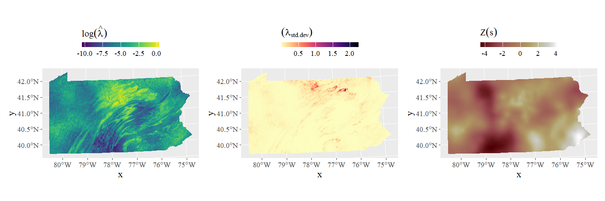{fig-align="center" width="777"}

## Discussion {.smaller auto-animate="true"}

- Over the last decade there has been bloom in the development of tools for fitting ISDMs (*with quite a few wrappers around INLA*).


## Discussion {.smaller auto-animate="true"}

- Over the last decade there has been bloom in the development of tools for fitting ISDMs (*with quite a few wrappers around INLA*).

- Despite their popular use, the increasing adoption of ISDMs calls for careful scrutiny, as these models should not be adopted uncritically.

## Discussion {.smaller auto-animate="true"}

- Over the last decade there has been bloom in the development of tools for fitting ISDMs (*with quite a few wrappers around INLA*).

- Despite their popular use, the increasing adoption of ISDMs calls for careful scrutiny, as these models should not be adopted uncritically.

- It is unclear whether an ISDM for the Black-throated Blue Warbler provides any more meaningful information than a point process model.

$$I_\theta(W)=n(\mathbf{s} \cap W) - \int_W\widehat{\lambda}_\theta(u) du$$

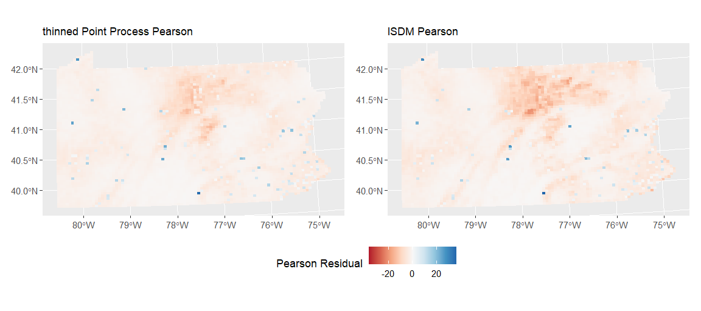{fig-align="center"}

## Discussion {.smaller auto-animate="true"}

- Over the last decade there has been bloom in the development of tools for fitting ISDMs (*with quite a few wrappers around INLA*).

- Despite their popular use, the increasing adoption of ISDMs calls for careful scrutiny, as these models should not be adopted uncritically.

- It is unclear whether an ISDM for the Black-throated Blue Warbler provides any more meaningful information than a point process model.

- This example has been presented as a case study for several works.

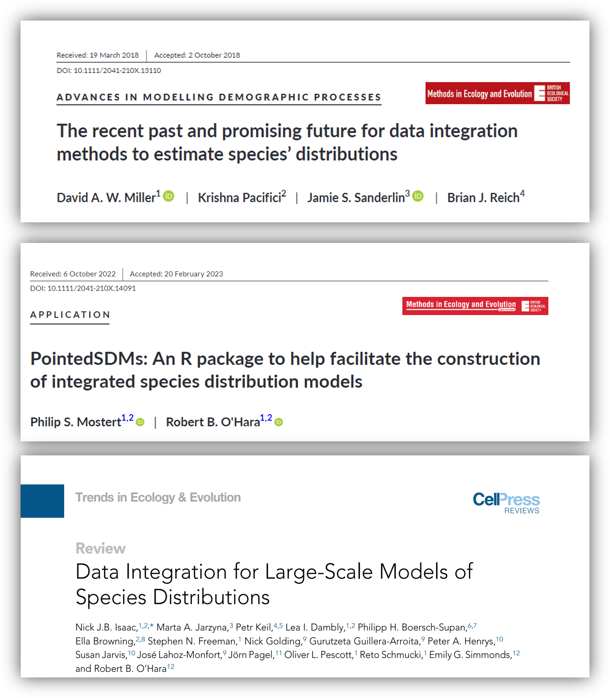{fig-align="center" width="540"}

## Discussion - further insights {.smaller auto-animate="true"}

- Do parameter-rich integrated models improve our ecological understanding?

- In many situations, the vast amount of unstructured data far exceeds the amount of survey data.

- Are integrated models even necessary when unstructured data has been adequately modeled?

## Discussion - further insights {.smaller auto-animate="true"}

- Do parameter-rich integrated models improve our ecological understanding?

  - How do we quantify the information gained by data integration?

- In many situations, the vast amount of unstructured data far exceeds the amount of survey data.

- Are integrated models even necessary when unstructured data has been adequately modeled?

## Discussion - further insights {.smaller auto-animate="true"}

- Do parameter-rich integrated models improve our ecological understanding?

- In many situations, the vast amount of unstructured data far exceeds the amount of survey data.

  - How can we weight high-quality survey data so that it isn't overwhelmed by unstructured data?

- Are integrated models even necessary when unstructured data has been adequately modeled?

## Discussion - further insights {.smaller auto-animate="true"}

- Do parameter-rich integrated models improve our ecological understanding?

- In many situations, the vast amount of unstructured data far exceeds the amount of survey data.

- Are integrated models even necessary when unstructured data has been adequately modeled?

  - How should we evaluate whether biases have been adequately modeled? 

## Discussion - further insights {.smaller auto-animate="true"}

- Do parameter-rich integrated models improve our ecological understanding?

- In many situations, the vast amount of unstructured data far exceeds the amount of survey data.

- Are integrated models even necessary when unstructured data has been adequately modeled?

{fig-align="center"}

## Where do I learn more about INLA and `inlabru` {.smaller}

::: {.callout-warning icon="false"}
##  Website-tutorials

`inlabru` <https://inlabru-org.github.io/inlabru/>

`R-INLA` <https://www.r-inla.org/home>
:::

::: {.callout-tip icon="false"}
##  Discussion forums

`inlabru` <https://github.com/inlabru-org/inlabru/discussions>

`R-INLA` <https://groups.google.com/g/r-inla-discussion-group>
:::

::: {.callout-note icon="false"}
##  Books

- Blangiardo, M., & Cameletti, M. (2015). Spatial and spatio-temporal Bayesian models with R-INLA. John Wiley & Sons.

- Gómez-Rubio, V. (2020). Bayesian inference with INLA. Chapman and Hall/CRC.

- Krainski, E., Gómez-Rubio, V., Bakka, H., Lenzi, A., Castro-Camilo, D., Simpson, D., ... & Rue, H. (2018). Advanced spatial modeling with stochastic partial differential equations using R and INLA. Chapman and Hall/CRC.

- Wang, X., Yue, Y. R., & Faraway, J. J. (2018). Bayesian regression modeling with INLA. Chapman and Hall/CRC.
:::

## Where do I learn more about INLA and `inlabru` {.smaller}

**`inlabru` workshops**

If interested get in touch!📧


<iframe src="inlabru-courses-map.html" width="100%" height="560" style="border:0;"></iframe>

## Where do I learn more about INLA and `inlabru` {.smaller}

**`inlabru` book ** *in process*


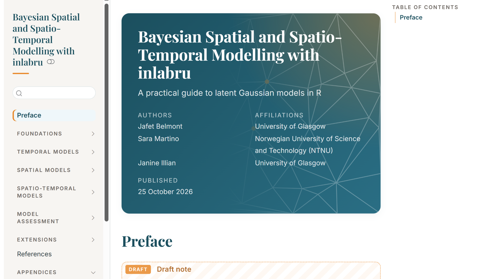


##  {background-image="background_video.gif" background-size="100%"}

::: {style="height: 150px;"}
:::

::: quote-gold
"*An understanding of the natural world, and what's in it as a source of not only great curiosity but great fulfillment.*" \> Sir. David Attenborough
:::

## References {.smaller}

::: {#refs}
:::

## Case Study: Scale effect of forest coverage on *Parus major* {.smaller}

The Swiss breeding bird survey ("Monitoring Häufige Brutvögel" MHB) has monitored the populations of approximately 150 common species since 1999.

- The MHB covers 267 1-km squares distributed across Switzerland and involves roughly 200 skilled birdwatchers annually, mainly volunteers.

- Surveys are conducted along a transect that does not change over the years and is 4-6 kms in length on average.

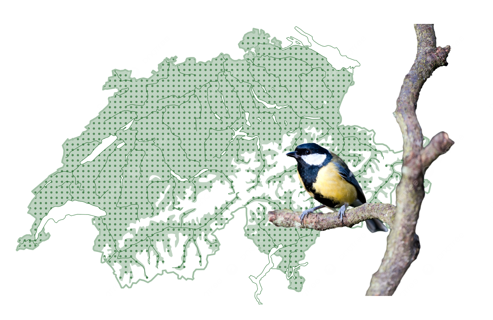{fig-align="center"}

## Case Study: Scale effect of forest coverage on *Parus major* {.smaller}

**Buffer analysis** using `inlabru` to determine the effect of forest coverage on the distribution of *Parus major*

$$ \begin{aligned} y_i &\sim \mathrm{Bernoulli}(\psi_i)\\ \mathrm{logit}(\psi_{i}) &= \beta_0 +\beta_1 \times p_{i,\delta} \end{aligned} $$ where $p_{i,\delta}$ denotes the percentage of the forest landscape in a buffer of radius $\delta \in 0.5~\text{Km},1~\text{Km}, \ldots, 5~\text{Km}$ centered on site $i$.

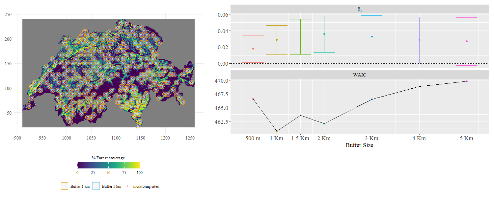{fig-align="center" width="748"}

## Case Study: Scale effect of forest coverage on *Parus major* {.smaller}

**Distance weighted analysis** to determine the effect of forest coverage on the distribution of *Parus major*

$$ \begin{aligned} y_i &\sim \mathrm{Bernoulli}(\theta_i)  \\ \mathrm{logit}(\psi_i) &= \beta_0+ \beta_1 \times f(x(\mathbf{s}_i,\sigma)) \\ f(x(\mathbf{s}_i,\sigma)) & = \sum_{i\neq j} f(\mathbf{s}_j)w(\mathbf{s}_i,\mathbf{s}_j,\sigma) \end{aligned} $$ **Results**

::::: columns
::: {.column width="50%"}
| Parameter | Post. mean and 95% CrIs |
|-----------|-------------------------|
| $\beta_0$ | **1.01** (0.19, 1.85 )  |
| $\beta_1$ | **0.01** (-0.01, 0.04)  |
| $\sigma$  | **1.14** (0.03, 4.59)   |
:::

::: {.column width="50%"}
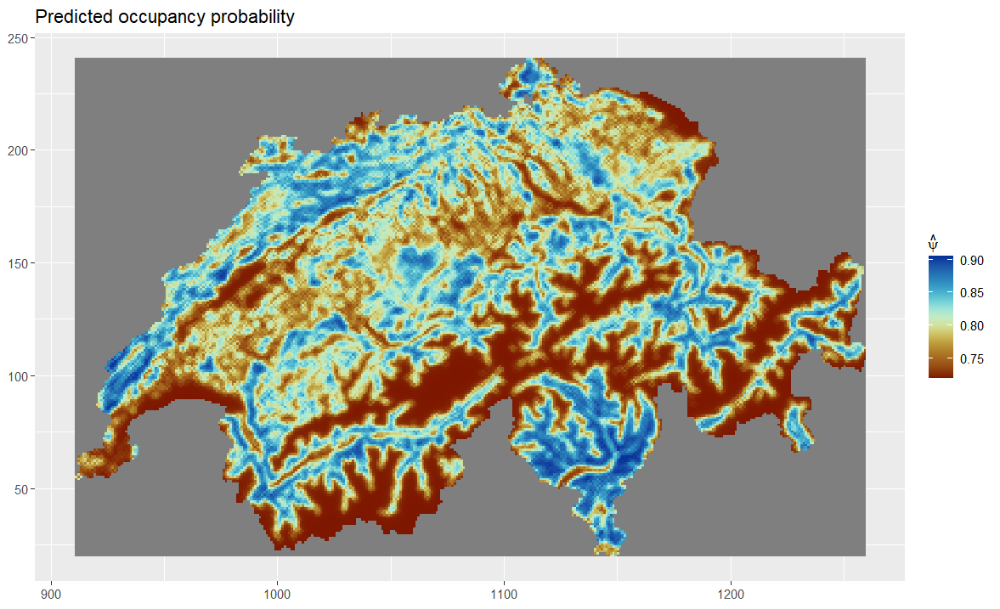{fig-align="center" width="580"}
:::
:::::

## Simulation Study {auto-animate="true"}

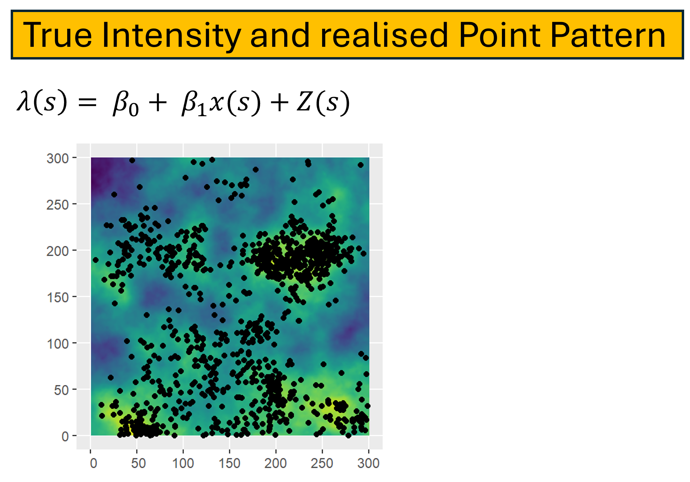{fig-align="center"}

## Simulation Study {auto-animate="true"}

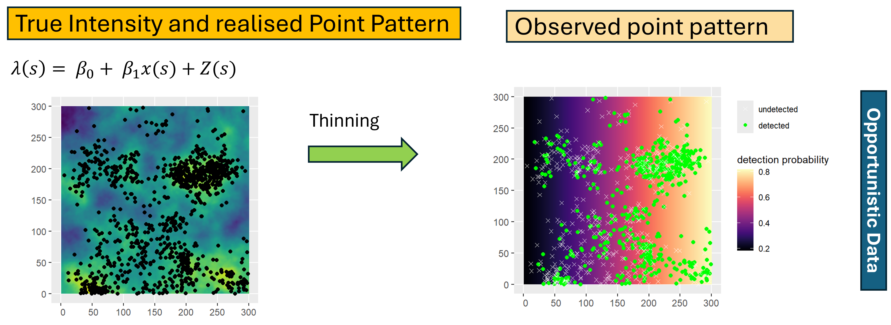{fig-align="center"}

## Simulation Study {auto-animate="true"}

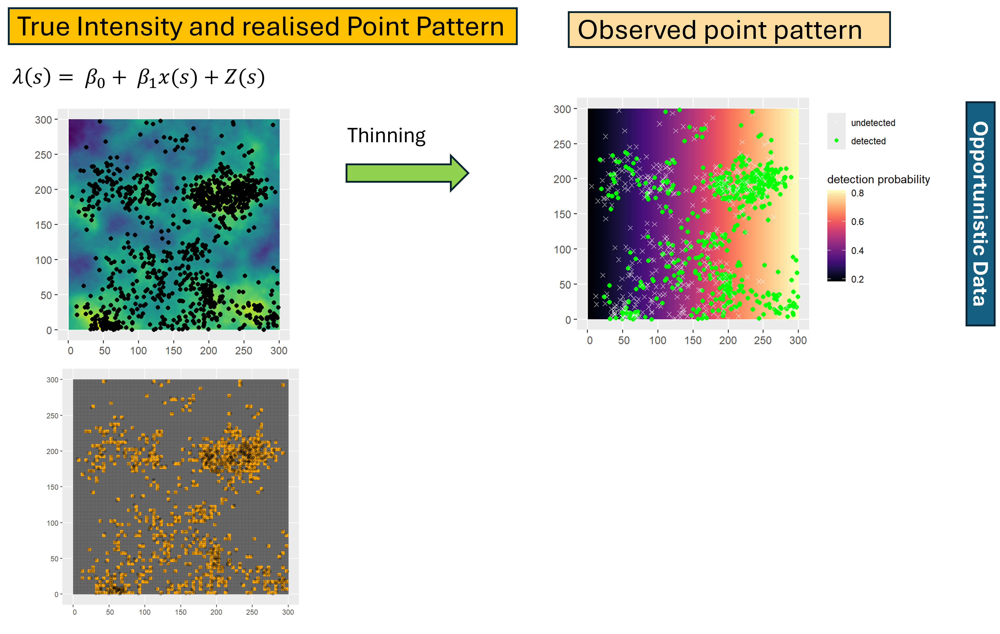{fig-align="center"}

## Simulation Study {auto-animate="true"}

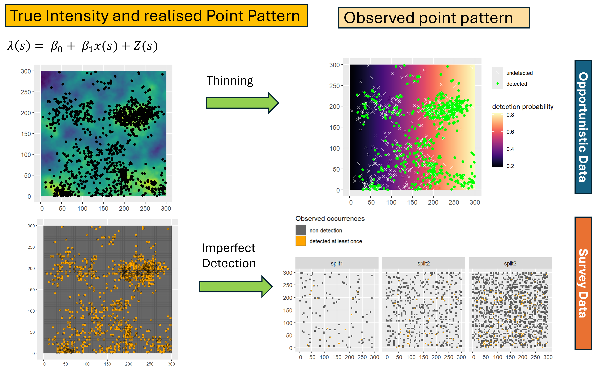{fig-align="center"}

## Simulation Study

- Compute MAE and correlation of $\lambda(s_{obs})$ and $\hat{\lambda(s_{obs})}$ across 100 data sets for each scenario.

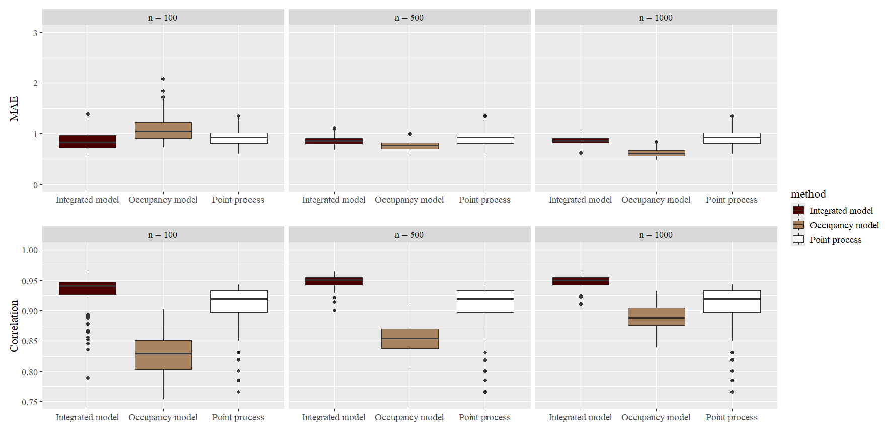{fig-align="center"}
